# 20261014 Local SFR Excess in NGC4654

I think the logic to detect the local SF enhancement due to RPS is the following: 

1. We define the pre-peak rSFMS first and then measure its intrinsic width ($W$). Then we further define the local SFR excess by $E = \frac{\Sigma_\mathrm{SFR}}{W}$, to measure where is star formation elevated relative to the pre-peak expectation at that stellar density. 
2. Then, not only just visually inspect the rSFMS of close-to-peak, we also compare the fraction of elevated SFR of close-to-peak galaxies with pre-peak sample, to see if we have any candidates that may have high-SFR-excess regions compareable to pre-peak samples. 
3. If any, then we can perform a Fourier decomposition of local SFR excess to determine the local SFR excess angle, and we also define the peak and opposite sectors of local SFR excess.  
4. Next we recalculate the fraction of local SFR excess in both sectors to double check if it is truely a local SF enhancement at this fitted angle. 
5. Finally, only at this stage we introduce the VIVA information to check if this fitted local maximum SFR excess angle coincides with the suggested RPS leading side from VIVA observation. 

## 1. Equal-galaxy pre-peak rSFMS fit and its intrinsic width

The intrinsic width is defined as taking each spaxcel ($i$)'s  $\Sigma_\mathrm{SFR}$ offset from the fitted rSFMS and subtracte it by $\Sigma_\mathrm{SFR}$ observational uncertainty, and then do the equal-galaxy weighted mean of them:
$$
W=\frac1G\sum_g\frac1{N_{g,\mathrm{err}}}\sum_i \sqrt{\max\{[y_{gi}-f(x_{gi})]^2-\sigma_{y,gi}^2,0\}}
$$
And the fitting result is 
$$
\log(\Sigma_\mathrm{SFR}/M_\odot\mathrm{yr}^{-1}\mathrm{kpc}^{-2}) = 0.960\log(\Sigma_*/M_\odot\mathrm{kpc}^{-2})-9.688
$$
with $W=0.348$ dex.

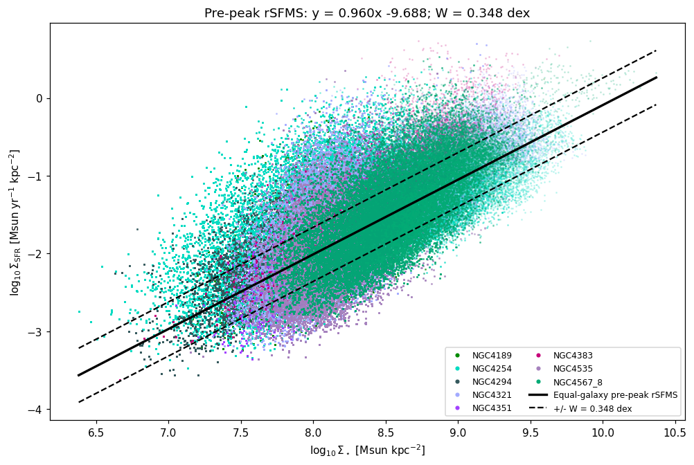

And we can also check the parameter space of close-to-peak samples. It turns out only NGC4424 and NGC4654 have SF spaxels extending to the upper edge of the pre-peak "cloud". And if we further consider the SF spaxel counts, then maybe NGC4654 is the only candidate.  

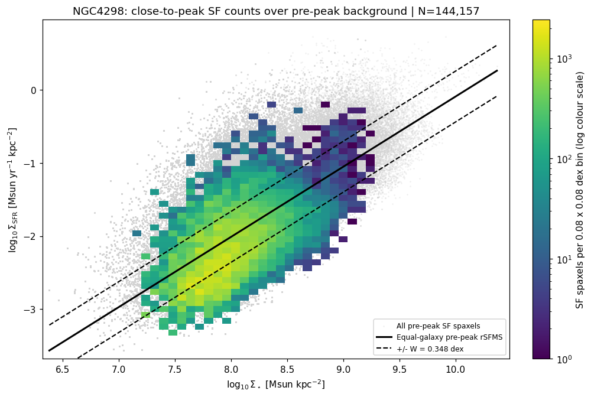

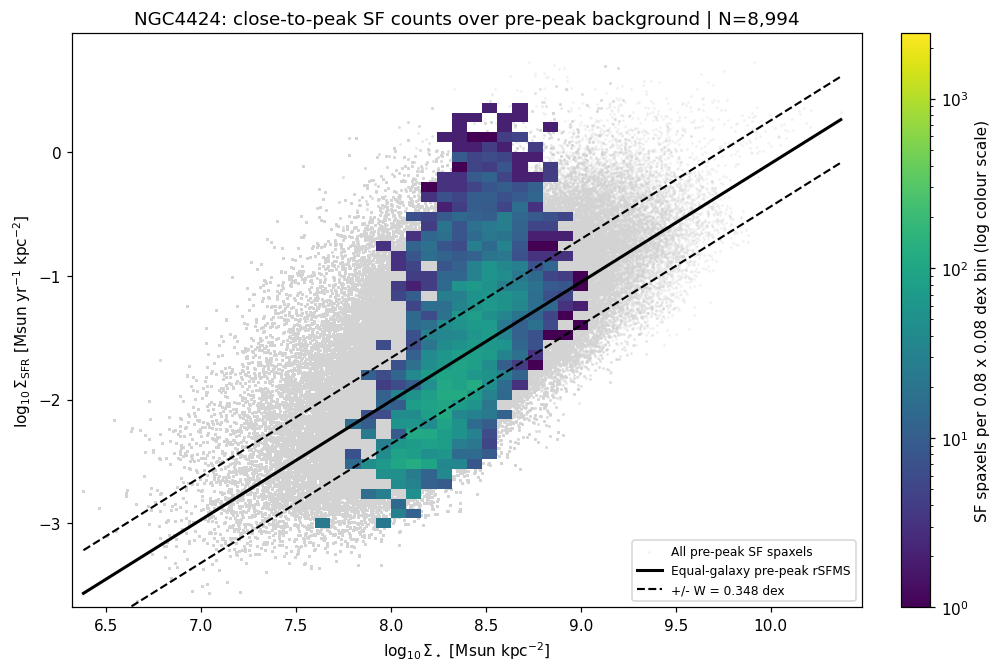

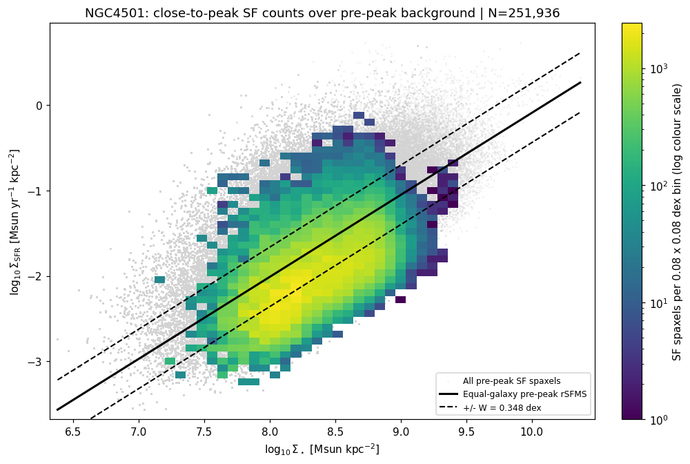

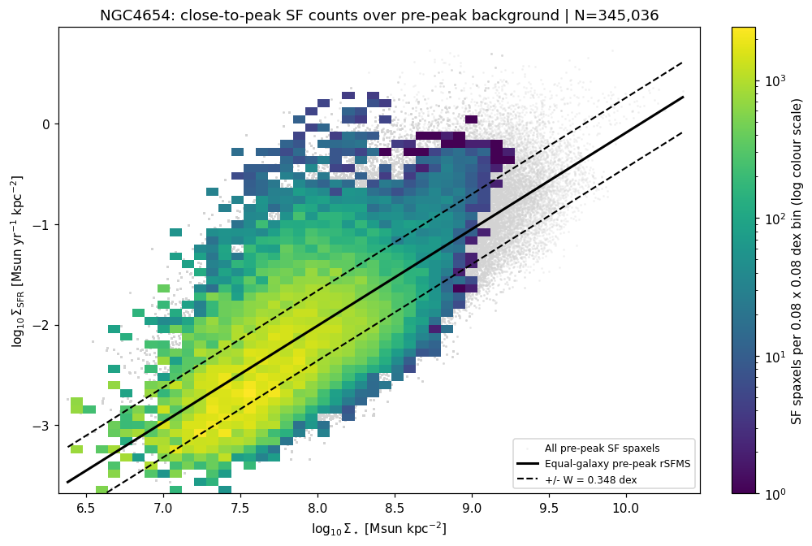

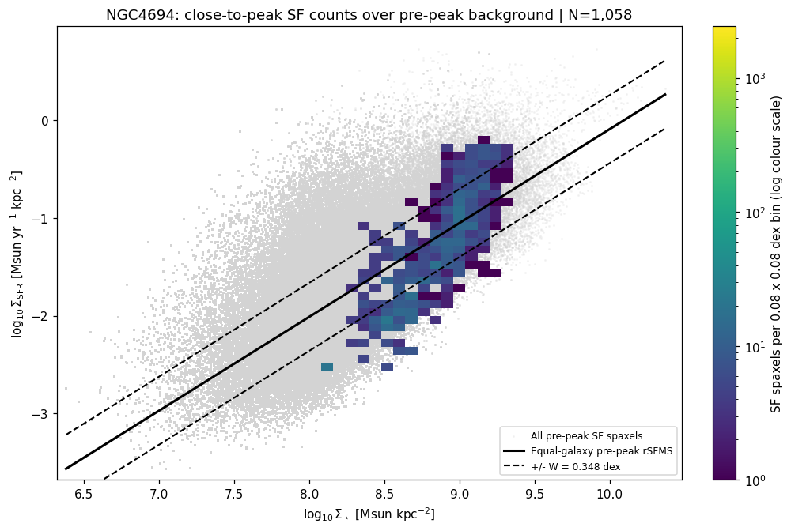

## 2. Local SFR excess and its fraction

Again, we define the local SFR excess (a normalized/dimentionless local SFR at given local stellar mass) as 
$$
E = \frac{\Sigma_\mathrm{SFR}}{W}
$$
Here we set 3 thresholds: $E>1,2,3$ and compute the fraction of elevated SFR spaxel out of all the SF spaxel in each close-to-peak galaxy. 

Again, we only have NGC4654 shows compareable local SFR excess fraction as pre-peak systems; while NGC4424 seems to have even a bit higher fraction but it is excluded due to not enough statistics. 

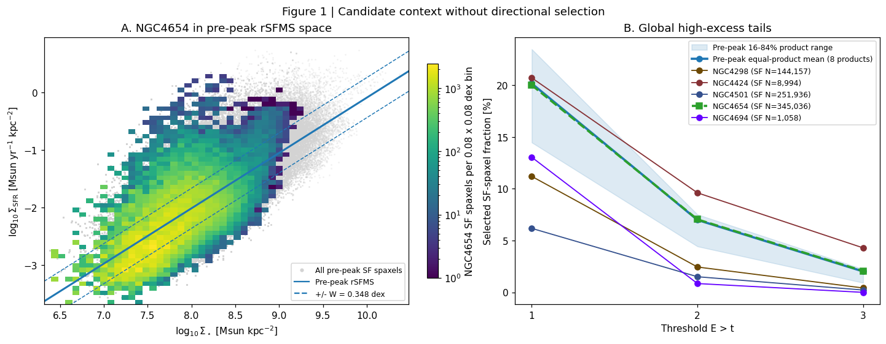

## 3. Fourier decomposition fitting 

The idea is that when we plot the $\Sigma_\mathrm{SFR}$ in the polar coordinate, we expect its "large-scale" distribution can be captured by 3 Fourier components: 1) $m=0$ to account for the radial profile; 2) $m=1$ to account for the lopsided / one-sided (axial-asymmetry) component, which is what we expect from RPS enhancement and suppression; and 3) m=2 to account for the two-sided (axial-symmetry) component, which could be bar, spiral arm, etc. 

To do the fitting, we also further divide the SF spaxels ($i$) into different annulus ($a$): $0-0.4R_e$,  $0.4-0.8R_e$,  $0.8-1.2R_e$,  $1.2-1.6R_e$ and  $1.6-2.0R_e$. In each annulu, we let parameters in $m=0,2$ freely vary, but they share the common parameters in $m=1$, so that the model can capture the variation of radial profile and axial-symmetry structure at different radius, but have a single SFR excess along a fixed direction. Hence, for SF spaxels ($i$) at annulus ($a$), with $r=R/R_e$ and midpoint $r_a$, we want to fit a Fourier decomposition model:
$$
\begin{aligned}
\widehat{E}_i ={}& \underbrace{\alpha_a+\beta_a(r_i-r_a)}_{m=0} \\[2.5ex]
&+ \underbrace{c_{2,a}\cos(2\theta_i)+s_{2,a}\sin(2\theta_i)}_{m=2} \\[2.5ex]
&+ \underbrace{c_1\cos\theta_i+s_1\sin\theta_i}_{m=1}.
\end{aligned}
$$
The shared $m=1$ amplitude and phase are both common across annuli:
$$
A_1=\sqrt{c_1^2+s_1^2},\qquad\theta_1=\operatorname{atan2}(s_1,c_1).
$$
 And as usual, we do a weighted fitting to make sure each bin contributes equally.

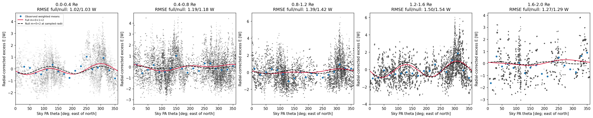

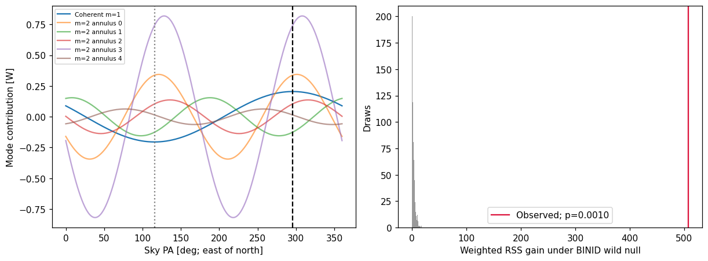

This gives $A_1=0.2$ and $\theta_1=295.68^\circ$, with p-value at 0.001. Here in panel c, I take the observed data to subtract the fitted model without $m=1$ omponent, and use the red curve to indicate the $m=1$ component to visualize how it captures the axial-asymmetry feature.

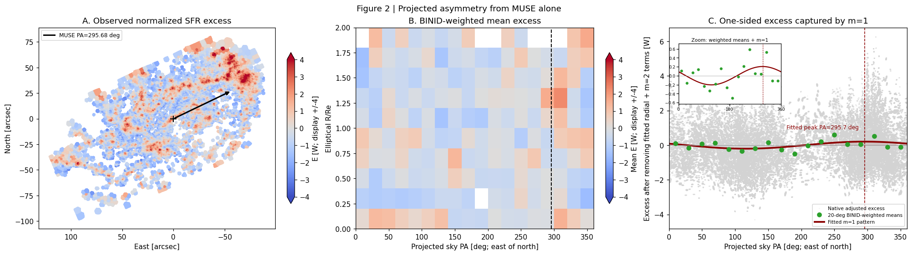

## 4. Local SFR excess fraction in peak and opposite sectors

Given the local SFR excess angle at $\theta_1=295.68^\circ$, we can define the peak sector with $\pm45^\circ$ and its corresponding opposite sector. Then we repeat the local SFR excess fractions in both sectors. And we can see that in the peak sector, the local SFR excess fractions are above the pre-peak range at all thresholds. 

And finally, we can check the VIVA observation suggest a North-West direction of RPS leading side, while our fitted local SFR excess angle also falls in this sector, and so this can be the confirmation of local SF enhancement due to RPS.

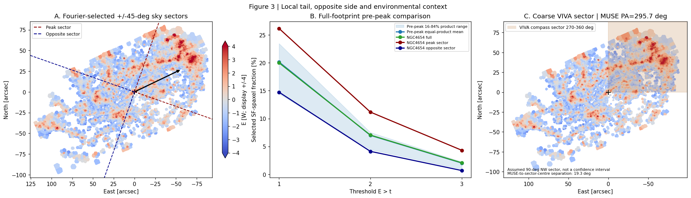

