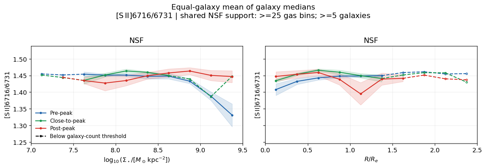
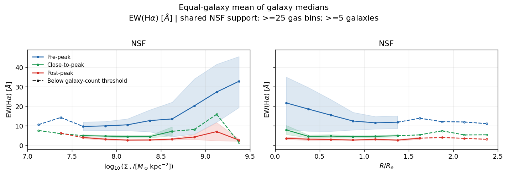
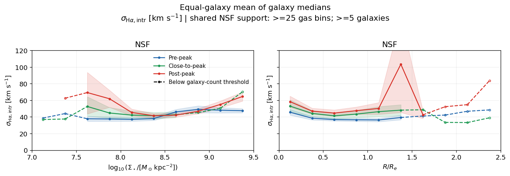
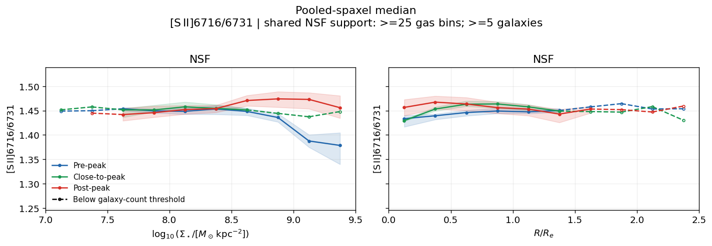
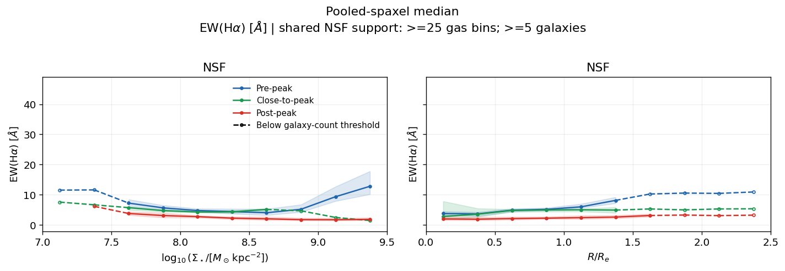
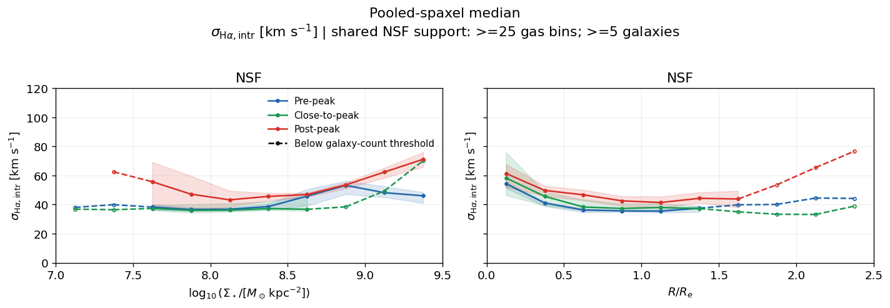

# 20261018 SII Ratio and EWHa in NSF across Infall Stages

Dashed lines are the regimes where each bin has less than 5 galaxies, so I label them as "incomplete" data by still show their trends.

So we can see all NSF regions are almost reaching the saturation limit (low electron density) of [S II] doublet ratio, but for $\log(\Sigma_*/M_\odot\mathrm{kpc^{-2}})>8.5$, the pre-peak sample shows the decreasing trend (higher electron density) toward 1.33. Although 1.33 corresponds to $n_e\sim100\mathrm{cm^{-3}}$ under the assumption of $T_e=10000K$, which is still roughly near the insensitive range of [S II] doublet ratio (Kewley+2019), I think this suggests the following signal: the high-mass end pre-peak NSF are potentially associated with a stronger contribution from leaked O/B photoionisation close to SF complexes, as what Baron+2026 found in PHANGS-MUSE, and so this support the relatively denser ionised structures/envelopes and less BPT line ratios here; while after RPS in post-peak, the dimishing of leaky photons revealing an increasing relative contribution from low-density, diffuse emission, potentially powered by HOLMES, and so this high-mass regime becomes lower electron density, lower EW, harder spectrum and potentially higher dispersion. 

As usual, we show the equal-galaxy weighted results and pool-spaxel results. 

