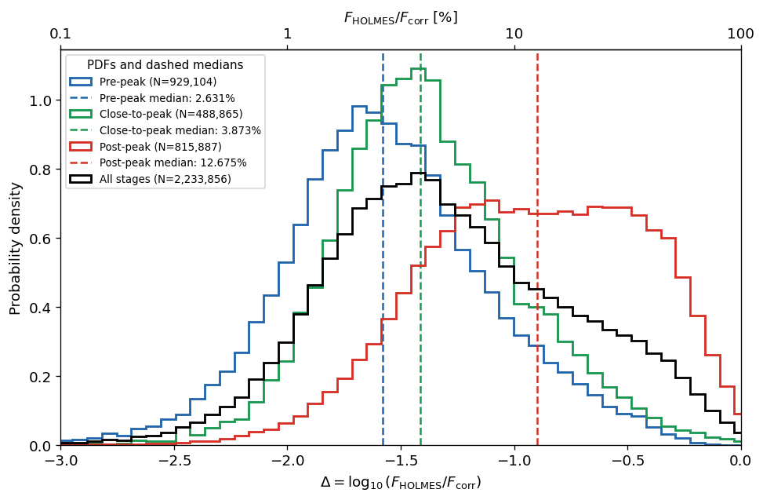
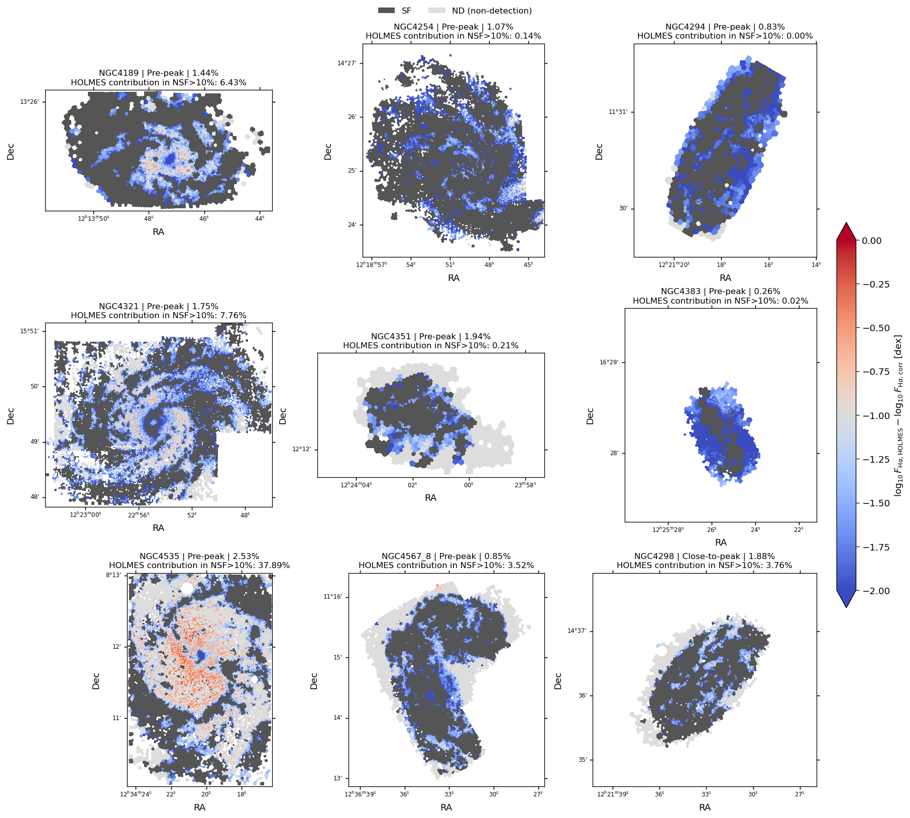
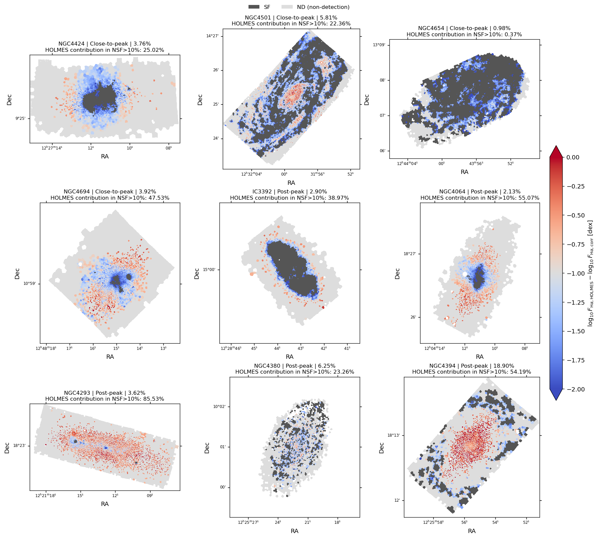
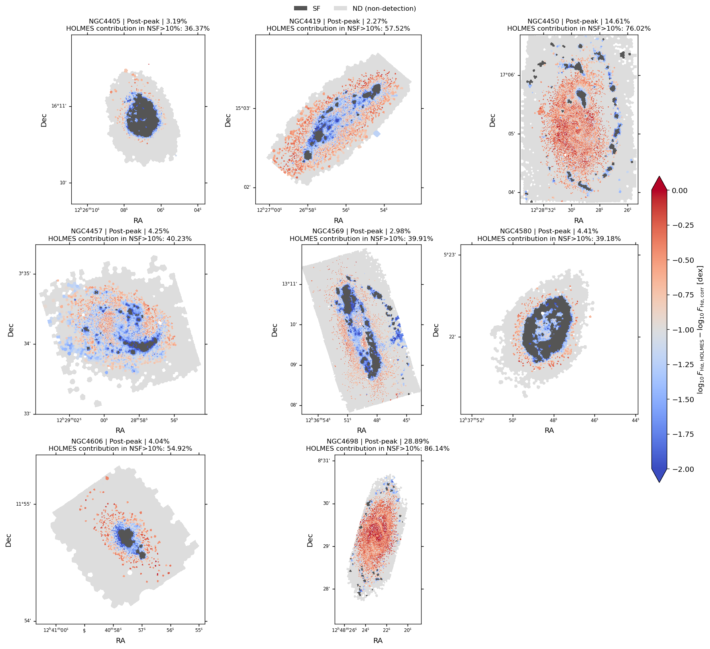

# 20261019 Necessity of HOLMES Contribution in Post-Peak NSF

All we need to do is to estimate the H$\alpha$ budget from HOLMES. Here, we assume the stellar mass are all contributed by old stellar ($\Sigma_*^{\rm old}\approx\Sigma_*$), then we have 
$$
\mathcal L_{\alpha,\rm HOLMES}=\epsilon_\alpha q_{\rm HOLMES}\Sigma_*^{\rm old}

=9.6047\times10^{28}\Sigma_*\quad [{\rm erg\,s^{-1}\,kpc^{-2}}],
$$
with $\epsilon_\alpha=1.3721\times10^{-12}$ erg (Cid Fernandes+2011) and $q_{\rm HOLMES}=7\times10^{40}\ \mathrm{s^{-1}}M_\odot^{-1}$ (Belfiore+2022). 

Then we can meaure the fraction of HOLMES contribution in observed corrected H$\alpha$ flux (or their differences in log scale) in NSF regions in either local or global scales. 

And below is the evidence that HOLMES contribution is significant in post-peak samples. We have a large porpotion (56.91%) of NSF spaxels in post-peak requires at least 10% of H$\alpha$ emission coming from HOLMES ionization, while in pre-peak and close-to-peak are just 11.42% and 17.07%. The reason why we adopt 10% contribution as the threshold is because in Belfiore+2022 model, they found that roughly 10% HOLMES contribution can move the line ratios across the BPT demacration curves. Even in Baron+2026 model that raise this threshold to 40%, we still have non-negligible 16.16% contribution in post-peak compared to 0.58% and 1.58% in pre-peak and close-to-peak. 

Also in integrated point of view, although the HOLMES contributions in total NSF H$\alpha$ flux are mostly just a few percent (consistent with PHANGS-MUSE observation), some post-peak galaxies like NGC4394, NGC4450 and NGC4698 can raise this value to $10\sim30\%$. 

The spatial maps of HOLMES contribution also confirm this. For example in NGC4698, where it has the SF regions settled at a $\sim4$ kpc ring, I dont think those leaky O/B photons is energetic enough to travel that distance to produce such luminous H$\alpha$ emission of the inner regions. 

Therefore, i think the way to reconcile the opposite models of Belfiore+2022 and Baron+2026 is that 1) in pre-peak or even close-to-peak, NSF regions are indeed mainly powered by leaky O/B photons and the HOLMES ionization may be negligible, and so the filtering effect in Baron+2026 alone is sufficient to explain the harder spectrum of DIG; 2) but when comes to our scenario that NSF regions also have elevated BPT line ratios after going through the RPS process, the HOLMES contribution becomes significant, then in this case the Baron+2026 model is insufficient to explain our observations and so we prefer the Belfiore+2022 interpretation. 