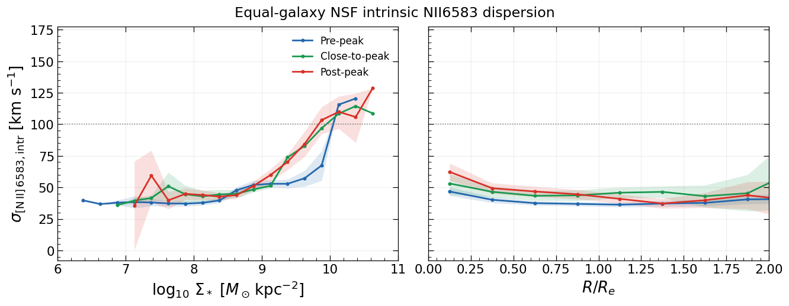
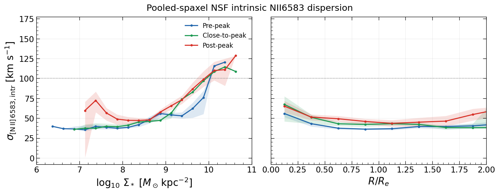

# 20261024 NII6583 Dispersion

If we dont perform any cut in stellar mass surface density range, I will say between $\log(\Sigma_*)=9-10$, we see increase of gas dispersion from pre-peak to post-peak. Note that close-to-peak galaxy only have 1 galaxy contributes to this local mass range. For radial trend, probably elevated within $1R_e$.  

