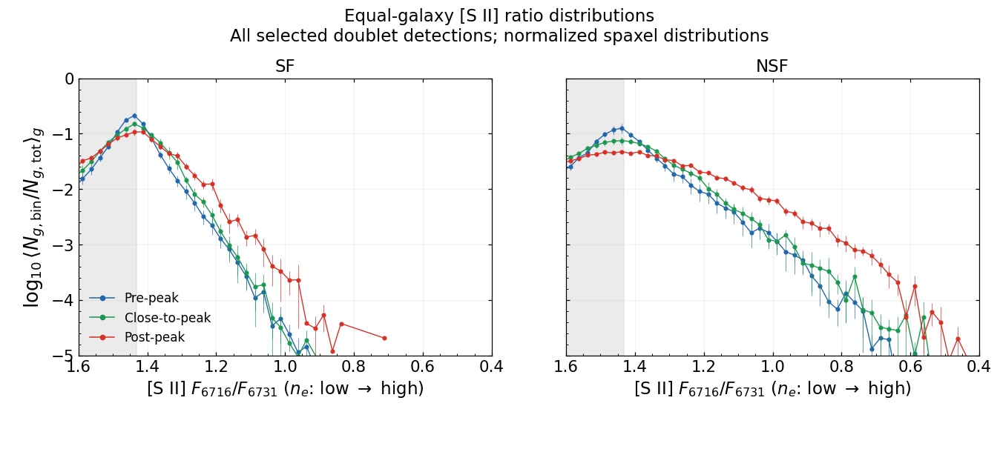
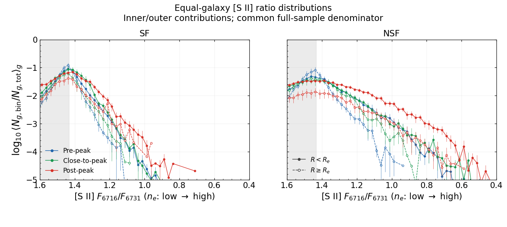
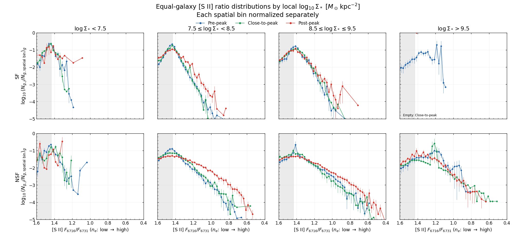
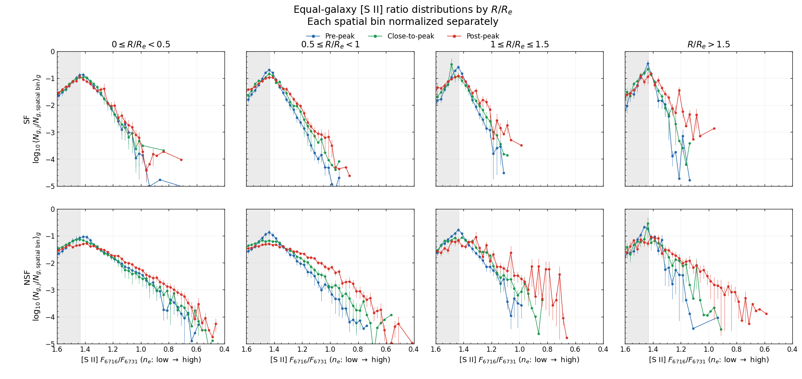
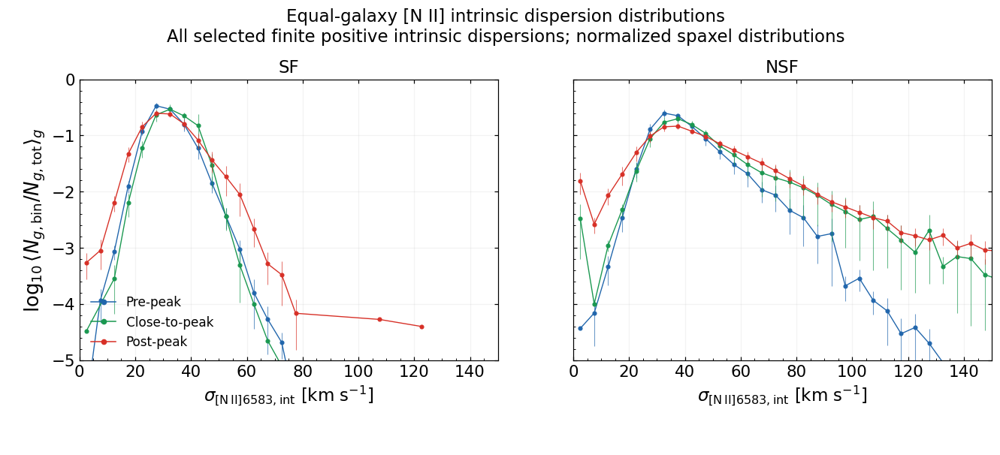
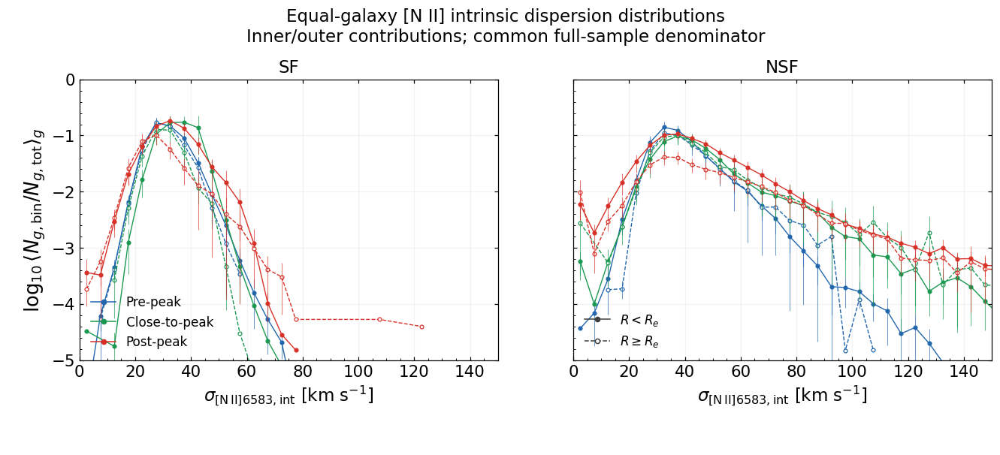
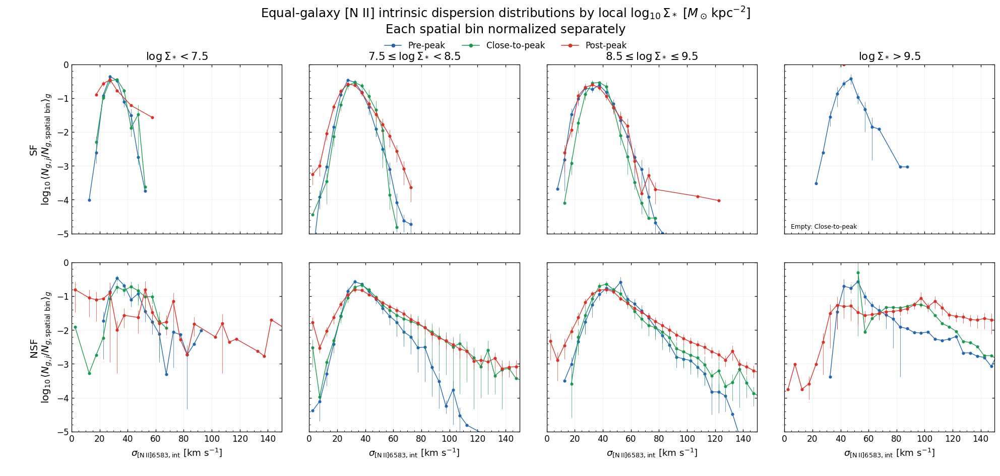
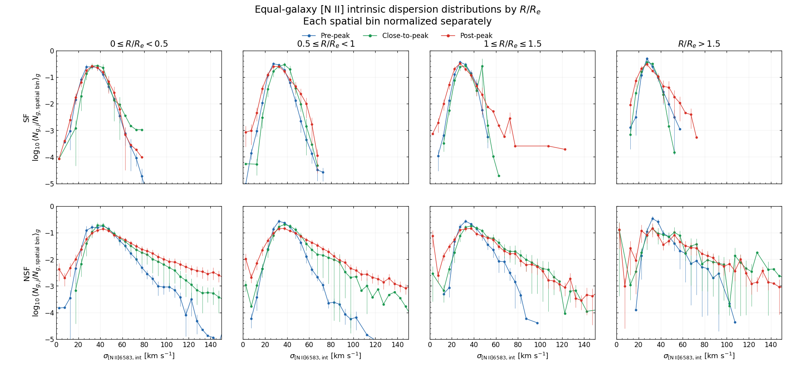

# 20261027 SII Doublet Ratio and NII Dispersion Distribution in SF and NSF

Follow the Figure 7 and 8 of VESTIGE XXI (Boselli+2026), we can show the normalised distribution of the [S II] doublet ratio (electron density). When lower than the [S II] sensitivity limit, we can clearly see that the post-peak galaxies have a larger fraction of dense either SF or NSF regions than pre-peak and close-to-peak samples. And both SF and NSF regions within $R_e$ are denser than those outside $R_e$. This is consistent with VESTIGE XXI (despite their $n_e$ range is completely below our saturation limit) and suggests the scenario that less-dense, diffuse gas is stripped away due to environmental interaction and so only more compact and dense gas remains in post-peak samples.  

And compared between SF and NSF regions, NSF regions also have higher fraction of dense gas and even extend to denser regime, probably due to the LINEAR emssion from the galactic central or bulge regions. 

And these distributions and trends still exist when we separate them into different mass and radial bins:

Similarly, we can repeat this for [N II] intrinsic dispersion. And obviously, due to our SF selection, the NSF have more turbulent ionized gas than SF regions. We can still see the trend that from pre-peak to close-to-peak and post-peak samples, the ionized gas becomes more pertubed due to the cluster environment, espicially in NSF regions. 

