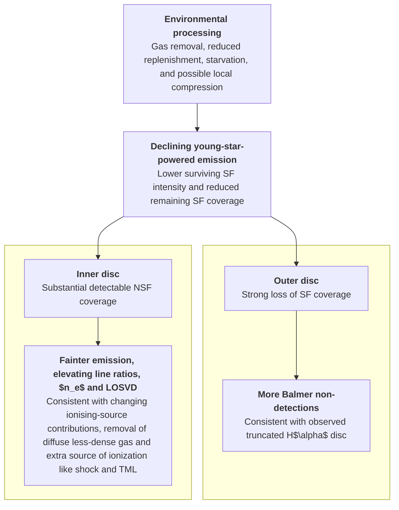

# 20261028 Surviving Star Formation and Remaining Ionized Gas in Virgo Galaxies

## 1. Previous works

### 1.1 Environmental SF suppression & outside-in quenching

We know that SF becomes spatially truncated and boardly suppressed. But what happens to the ionised-gas emission across the rest of the stellar disc? 

-> Spatial Footprint of Star Formation and Ionised Gas: SF/NSF/ND. 

#### 1.1.1 [Koopmann & Kenney (2004)](https://iopscience.iop.org/article/10.1086/423191). 

Virgo spirals frequently have truncated SF discs, often retaining normal or enhanced central SF.

We do see SF becomes ND in low-mass outskirts, but the overall intensity of surviving inner high-mass SF also tends to decrease.

#### 1.1.2 [Boselli et al. (2020), VESTIGE VI](https://doi.org/10.1051/0004-6361/201937310)

H I-deficient Virgo galaxies have fewer H II regions, especially beyond \(R_e\).

We do see SF becomes ND in low-mass outskirts. 

#### 1.1.3 [Morgan et al. (2024), VESTIGE XVI](https://doi.org/10.1051/0004-6361/202449225)

Moderate SF-disc truncation can arise from starvation with a star-formation threshold, not exclusively direct stripping. 

We do see SF becomes ND in low-mass outskirts, but we didn't distinguish them between starvation and stripping effect.

#### 1.1.4 [Çakır et al. (2026), SAMI](https://doi.org/10.1017/pasa.2026.10157)

Asymmetric and truncated cluster galaxies exhibit increasingly suppressed outer SF, while central SF remains broadly comparable to controls.

We do see SF becomes ND in low-mass outskirts, but the overall intensity of surviving inner high-mass SF also tends to decrease.

### 1.2 Is environmental suppression only the disappearance of SF regions, or does surviving SF also become weaker?

$$
\text{SF suppression} = \text{Reduced SF coverage} + \text{Reduced surviving SF intensity}
$$

In later-stage populations, the current measurements indicate that star-forming locations are not merely less widespread; the surviving SF-selected region is also generally weaker at comparable local stellar surface density

#### 1.2.1 [Brown et al. (2023), VERTICO VII](https://doi.org/10.3847/1538-4357/acf195)

At 720 pc, H I-poor Virgo galaxies have an approximately 0.5 dex suppression in resolved SFR surface density, associated with lower molecular content and SFE.

Strong agreement. Our opportunity is finer-scale conditional SF measurements and their connection to spatial coverage.

#### 1.2.2 [Boselli et al. (2026), VESTIGE XXI](https://doi.org/10.1051/0004-6361/202659463)

Perturbed galaxies host fewer H II regions at fixed host stellar mass. Their brightest regions are less luminous at fixed host stellar mass, but not significantly different at fixed global SFR. Their luminosity functions do not indicate uniform fading. 

We do not segment individual H II regions to investigate the luminosity function, but we do find that at fixed local stellar mass, later stages tend to show less SFR. 

#### 1.2.3 [Pessa et al. (2021), PHANGS-MUSE](https://doi.org/10.1051/0004-6361/202140733)

At approximately 100 pc, the rSFMS (both slope and normalization) depends significantly on non-detections, averaging conventions, and spatial resolution. 

When we accout for the NSF and ND spaxel as what they do and treat then as upper limit, our mean liear align with PHANGS-MUSE fitting line. 

### 1.3 Local SF enhancement due to environmental interaction?

NGC4654 and NGC4424 in close-to-peak, NGC4064 in post-peak. 

This part seems controversial. GASP find elevated integrated and spatially resolved SF in selected stripping galaxies ([Vulcani et al. 2018](https://doi.org/10.3847/2041-8213/aae68b), [2020b](https://doi.org/10.3847/1538-4357/aba4ae)). Their HST imaging further find that in strong stripping galaxies, star-forming clumps have an enhanced H$\alpha$ luminosity at a given size, compared to the clumps in main-sequence galaxies ([Giunchi et al. 2023](https://doi.org/10.3847/1538-4357/acc5ee)). In Virgo, the central regions of NGC4424,  compressed regions of IC 3476 and NGC 4654 provide resolved examples of enhanced activity ([Boselli et al. 2018](https://doi.org/10.1051/0004-6361/201833914); [Boselli et al. 2021](https://doi.org/10.1051/0004-6361/202039046); [Lizee et al. 2021](https://doi.org/10.1051/0004-6361/202038910)). However, a large UNIONS satellite sample shows no systematic asymmetric enhancement, while TNG50 simulations also show no enhanced population-wide star formation. ([Foster et al. 2025](https://arxiv.org/abs/2502.13123); [Goller et al. 2023](https://arxiv.org/abs/2304.09199)). 

Perhaps it is true that we broadly observe the SF suppression, but maybe catch the local short-timescale SF enhancement under some condition if we are lucky.  

### 1.4 What happens to ionised gas after the contribution from SF declines?

#### 1.4.1 [Belfiore et al. (2016), MaNGA](https://doi.org/10.1093/mnras/stw1234); [Belfiore et al. (2017), MaNGA](https://doi.org/10.1093/mnras/stw3211)

LIER-like emission can persist over extended regions with weak recent SF.

Yes we do detect that. 

#### 1.4.2 [Zhang et al. (2017), MaNGA](https://doi.org/10.1093/mnras/stw3308)

Low-Hα-surface-brightness regions commonly have enhanced low-ionisation diagnostic ratios.

Agree, but O3 as well. 

#### 1.4.3 [Tomicic et al. (2021), GASP XXXII](https://doi.org/10.3847/1538-4357/abca93)

No clear difference between stripped and control samples in the integrated DIG H$\alpha$ contribution, despite a wide range of diffuse fractions. 

ok, but we are looking at NSF fraction. 

#### 1.4.4 [Tomicic et al. (2021), GASP XXXV](https://doi.org/10.3847/1538-4357/ac230e)

Diffuse tails can also exhibit excess [O I]/H$\alpha$ requiring additional excitation, potentially involving shocks or interactions with the hot ISM/ICM. 

ok, we instead looking at other BPT line ratios, electron density, the [N II] dispersion in NSF regions, and all are higher in later stages. 

#### 1.4.5 [Law et al. (2021), MaNGA]()

Association between broader emission lines (LOSVD) and non-H II-like excitation. 

True, we do observe higher [N II] dispersion in NSF, also in later stages. 

#### 1.4.6 [Allen et al. (2008), MAPINGS III](https://doi.org/10.1086/589652)

Shock model demonstrates how mechanical energy can modify optical line spectra. 

So our observed elevated BPT line ratios may also partially due to increase of shock excitation. 

#### 1.4.7 [Boselli et al. (2026), VESTIGE XXI](https://doi.org/10.1051/0004-6361/202659463)

H I-poor H II regions have higher $n_e$.  

We can clearly see that the post-peak galaxies have a larger fraction of dense either SF or NSF regions than pre-peak and close-to-peak samples. And both SF and NSF regions within $R_e$ are denser than those outside $R_e$. So this suggests that less-dense, diffuse gas is stripped away due to environmental interaction and so only more compact and dense gas remains in post-peak samples.  

## 2. Link everything together - Schematic scientific narrative 

## 3. Paper Structure

1. Introduction. Establish the connection missing from previous work
2. Observations and methods. Define the sample, environmental stages, emission categories, and measurements. 
3. The Environmental Dependence of Resolved Star Formation. rSFMS, surviving SF intensity, and local enhancement (details study of NGC4654 may go to Appendix)
4. The Spatial Footprint of Star Formation and Ionised Gas. The loss of SF fraction goes to ND in outer, low-mass regions, and NSF in inner, high-mass regions. SF and NSF distribution of $n_e$ and [N II] dispersion.
5. The Emission Properties and Excitation of Non-Star-Forming Regions. Fading of emission line intensity but increasing of BPT line ratios in NSF.
6. Linking Star Formation Suppression to Ionised-Gas Excitation (the analytical model)
7. Discussion. Comparing our observation with previous studies. 
8. Conclusion. 