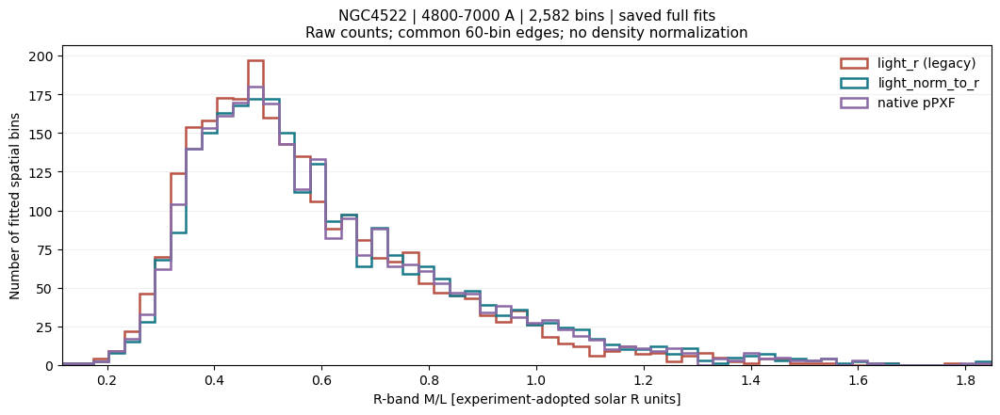
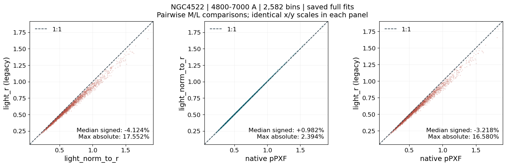
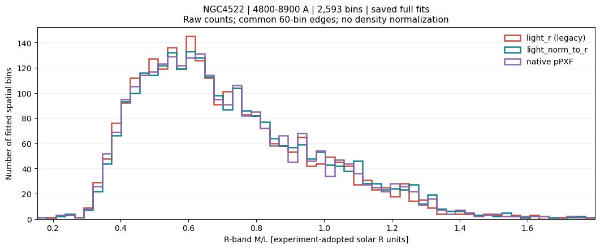
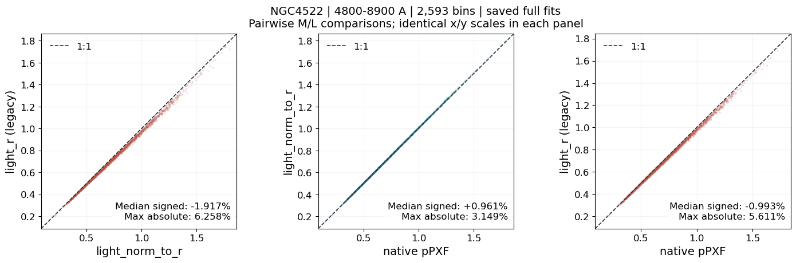
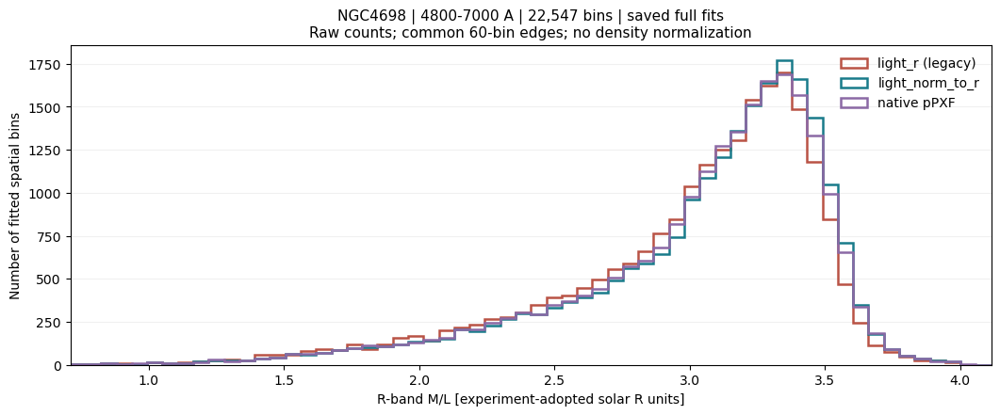
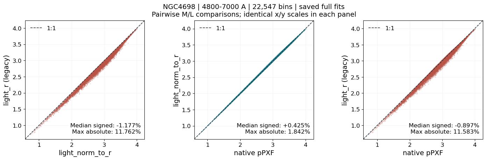
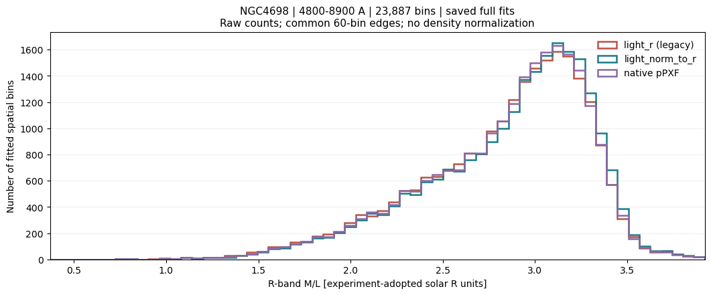
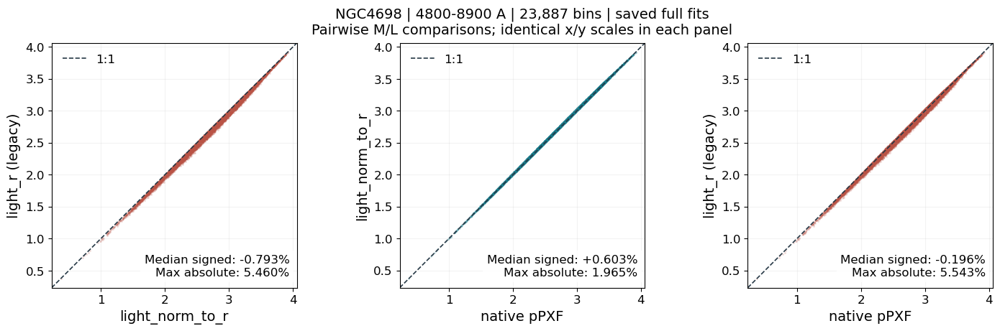
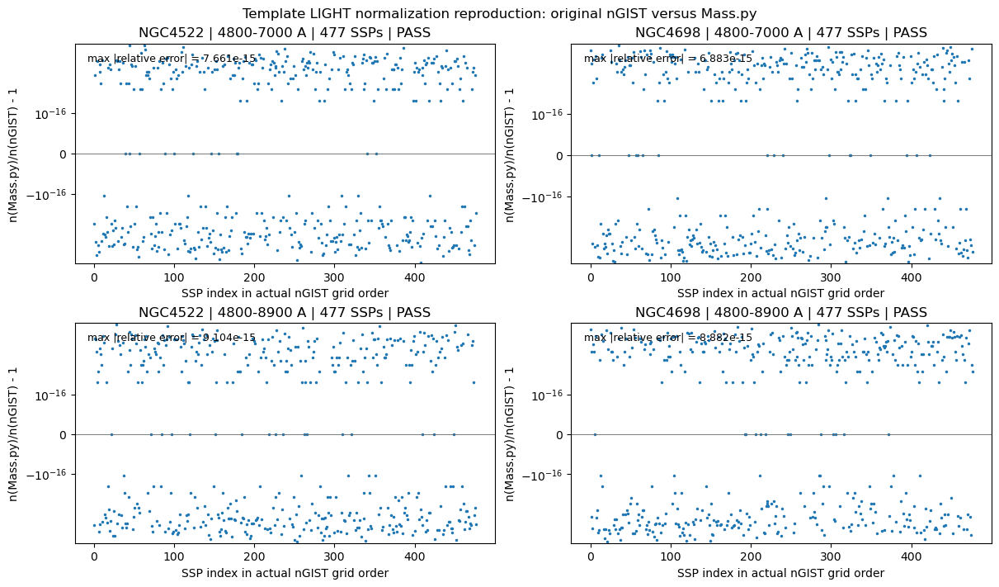
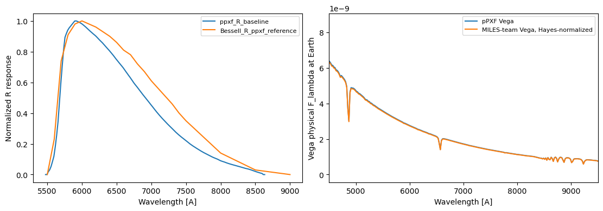

# 20261101 The Most Appropriate Mass to Light Ratio for nGIST

## 1. 3 different composite $M/L$ approaches

There are 3 different approaches to construct the composite (mixture) $M/L$ for each spaxel/bin from `nGIST` fitting LIGHT weight ($w$). 

| Method                         | Treatment of fitted coefficients                             | Mixture M/L                                                  |
| ------------------------------ | ------------------------------------------------------------ | ------------------------------------------------------------ |
| `pPXF` `sps_lib.mass_to_light` | Uses the normalization factors stored by its SPS helper; computes band luminosities from spectra | Total stellar mass / total band luminosity. The reference approach, but it is not enabled in current `nGIST`. |
| `light_r`                      | Treats the saved coefficients $w$ directly as R-light fractions | Arithmetic mean of SSP $M/L$ weighted by those coefficients. It does not account for the SSP template preparation, normalization and target photometry. |
| `light_norm_to_r`              | Reconstructs `nGIST`'s factors, converts saved LIGHT coefficients into R-light fractions | Exactly the total-mass / total-R-light expression. It reproduces the `nGIST`/`ppxf` procedure to construct the traget band's contribution. |

## 2. Definitions and the general mass-to-light identity

For SSP index $j$, define:

| Symbol                          | Meaning                                                      |
| ------------------------------- | ------------------------------------------------------------ |
| $S_j(\lambda)$                  | Original physical SSP spectrum with the library's population normalization |
| $P_j(\lambda)$                  | SSP after the preparation used for fitting, before LIGHT normalization |
| $n_j$                           | Scalar used to divide that prepared SSP                      |
| $T_j(\lambda)=P_j(\lambda)/n_j$ | Normalized template supplied to the fit                      |
| $w_j$                           | Coefficient multiplying $T_j$; an overall common scale is immaterial |
| $a_j=w_j/n_j$                   | Coefficient of the SSP on its original population-amplitude scale |
| $M_j$                           | Stellar mass associated with the original SSP population normalization |
| $L_{R,j}$                       | R-band luminosity of that same SSP population                |
| $\Upsilon_{R,j}=M_j/L_{R,j}$    | Individual SSP stellar $M/L$ in solar R-band units           |

Preparation changes sampling and spectral resolution; the SSP population
amplitude is tracked separately from the scalar LIGHT division. The population
mixture represented by the fit has prepared spectrum

$$
P_{\rm mix}(\lambda)
=\sum_j w_jT_j(\lambda)
=\sum_j\frac{w_j}{n_j}P_j(\lambda).
$$

The same population amplitudes multiply the corresponding stellar masses and
band luminosities. Therefore

$$
\boxed{
\Upsilon_R
=\frac{\sum_j a_jM_j}{\sum_j a_jL_{R,j}}
=\frac{\sum_j(w_j/n_j)M_j}{\sum_j(w_j/n_j)L_{R,j}}.
}
$$

Multiplying every $w_j$ by the same positive constant changes neither ratio.
The coefficients $a_j$ are population amplitudes; surviving stellar-mass
contributions are $a_jM_j$. By definition, $w_j/n_j$ is the MASS weights. 

## 3. How pPXF obtains composite $M/L$ from fitted LIGHT weights

### 3.1 The fit and the $M/L$ helper are separate operations

The pPXF release history records the generalization of this helper to arbitrary
SPS models, filters and redshifts in version 9.1.1 (See the [official pPXF changelog](https://pypi.org/project/ppxf/#changelog)):

```text
V9.1.1: MC, Oxford, 18 January 2024
sps_util.mass_to_light: Now it can calculate the stellar mass-to-light ratio (M*/L) for any stellar population synthesis (SPS) model, any filter, and any redshift, using the output weights from pPXF. No need for pre-computed tables anymore.
```

Thus pPXF provides a function that directly returns the mixture $M/L$. 

### 3.2 Template normalization in the our `pPXF` 9.4.2 SPS helper

The helper loads the spectral library, wavelength grid, stellar masses, ages,
metallicities and spectral resolutions. When resolution matching is requested,
it broadens the spectra, then logarithmically rebins them.

With `norm_range` specified and `norm_type='mean'`, it measures each template's
mean over the selected log-sampled wavelength interval and divides that
template by its own factor. It retains those factors in `sps.flux`. The fit
then returns coefficients of these individually normalized templates.

```python
self.flux = flux            # factor by which each template was divided
self.mass_no_gas_grid = masses
```

In the notation of this report, `self.flux[j]` is $n_j$ and
`self.mass_no_gas_grid[j]` is $M_j$. The attribute name `flux` should not be
mistaken for the R-band luminosity: it records the normalization divisor.

### 3.3 The $M/L$ calculation

The decisive calculation is reproduced directly from
[sps_util.py](/opt/miniconda3/envs/ICRAR/lib/python3.13/site-packages/ppxf/sps_util.py:298):

```python
mass_weights = weights/self.flux    # Revert possible templates normalization
lum = p1.flux/p2.flux               # Lum in solar luminosities
mlpop = np.sum(mass_weights*self.mass_no_gas_grid)/np.sum(weights*lum)
```

The code-to-equation correspondence is:

| Code quantity           | Mathematical quantity                                        | Interpretation                                               |
| ----------------------- | ------------------------------------------------------------ | ------------------------------------------------------------ |
| `weights`               | $w_j$                                                        | Coefficients multiplying the normalized fitting templates    |
| `self.flux`             | $n_j$                                                        | Per-template normalization divisors                          |
| `mass_weights`          | $w_j/n_j$                                                    | Coefficients restored to the original SSP population scale   |
| `self.mass_no_gas_grid` | $M_j$                                                        | Stellar mass for that original SSP population                |
| `p1.flux`               | Band flux of the normalized SSP, after the code's unit conversion | Obtained by synthetic photometry of `self.templates_full`    |
| `p2.flux`               | Solar reference band flux                                    | Converts the SSP band flux into solar band-luminosity units  |
| `lum`                   | $\widetilde L_{R,j}=L_{R,j}/n_j$                             | Band luminosity of the already normalized SSP                |
| `mlpop`                 | $\Upsilon_R$                                                 | Total mixture stellar mass divided by total mixture band luminosity |

In particular, `lum` is a band-integrated photometric quantity, not the
template's wavelength-by-wavelength flux array. The general helper uses the
requested band; the $R$ subscript in this table describes its R-band use.

Let $\widetilde L_{R,j}$ denote the luminosity measured from the normalized
template. Linearity of the bandpass measurement gives

$$
\widetilde L_{R,j}=\frac{L_{R,j}}{n_j}.
$$

The helper combines mass contributions proportional to $(w_j/n_j)M_j$ and
luminosity contributions proportional to $w_j\widetilde L_{R,j}$. Thus
$$
\Upsilon_R^{\rm pPXF}
=\frac{\sum_j(w_j/n_j)M_j}{\sum_jw_j\widetilde L_{R,j}}
=\frac{\sum_j(w_j/n_j)M_j}{\sum_j(w_j/n_j)\ell_{R,j}}.
$$

The denominator does not need another explicit division by $n_j$: the spectra
used for its synthetic photometry were already divided by $n_j$.

## 4. What nGIST saves: LIGHT weights

In our `nGIST` v7.6.8 configuration, the current standard SFH method is `ppxf` and its template preparation uses `TEMPLATE_SET: miles`,  `NORM_TEMP: LIGHT` and our customized SSP template library `LIBRARY=EMILES_baseFe_safe/`. 

The [template-preparation source](https://github.com/geckos-survey/ngist/blob/038e9fa4839758e9dae53baeaf93a82bd75d8026/ngistPipeline/prepareTemplates/miles.py) divides each prepared SSP by its mean. Its coefficients consequently describe contributions in this mean-flux normalization convention. 

The [SFH wrapper](https://github.com/geckos-survey/ngist/blob/038e9fa4839758e9dae53baeaf93a82bd75d8026/ngistPipeline/starFormationHistories/ppxf_sfh_wrapper.py) reshapes the final fitted coefficients and divides them by their total to make sure they summed up to 1 before returning and saving them. In symbols, if $u_{bj}$ are the coefficients returned by pPXF for bin $b$, the saved values are
$$
w_{bj}=\frac{u_{bj}}{\sum_k u_{bk}}.
$$

Below is the `nGIST` souce code ([ppxf_sfh_wrapper.py](https://github.com/geckos-survey/ngist/blob/038e9fa4839758e9dae53baeaf93a82bd75d8026/ngistPipeline/starFormationHistories/ppxf_sfh_wrapper.py#L426-L435)):

```python
normalized_weights = pp.weights / np.sum( pp.weights )

weights = pp.weights.reshape(templates.shape[1:])/pp.weights.sum()
w_row   = np.array([np.reshape(weights, ncomb)])
```

Note that the `mass_to_light` helper in pPXF's `sps_util` module is not invoked in current `nGIST` workflow. 

## 5. The `light_r` calculation and its required assumption

The `light_r` branch computes

$$
\Upsilon_{R,b}^{\texttt{light\_r}}
=\frac{\sum_jw_{bj}\Upsilon_{R,j}}{\sum_jw_{bj}}.
$$

An arithmetic mean of SSP $M/L$ values is correct when its weights are the
SSPs' R-band light fractions. However, nGIST's saved LIGHT coefficients are
coefficients of mean-normalized prepared spectral templates. Their associated R-band contributions are proportional to $w_{bj}L_{R,j}/n_j$, not simply $w_{bj}$.

Consequently `light_r` generally uses the wrong weighting measure for this
workflow, and so this leads to underestimation when older population is outshined by younger stellars. 

## 6. The `light_norm_to_r` calculation and proof of mathematical equivalence

### 6.1 Recover R-band contributions

For each bin, the current [Mass.py](https://github.com/Rongjun-ANU/ICRAR-MAUVE/blob/main/further/Mass.py) computes

$$
q_{bj}=w_{bj}\frac{\ell_{R,j}}{n_j},
\qquad
f_{R,bj}=\frac{q_{bj}}{\sum_kq_{bk}},
$$

where the table-based proxy is

$$
\ell_{R,j}=10^{-0.4\mathcal M_{R,j}}.
$$

Here $\mathcal M_{R,j}$ is the SSP absolute R magnitude. 

### 6.2 Combine the SSP $M/L$ values

The final calculation is

$$
\Upsilon_{R,b}^{\texttt{light\_norm\_to\_r}}
=\sum_j f_{R,bj}\Upsilon_{R,j}.
$$

Substitution gives the complete equivalence:

$$
\begin{aligned}
\Upsilon_{R,b}^{\texttt{light\_norm\_to\_r}}
&=\frac{\sum_j(w_{bj}/n_j)L_{R,j}\Upsilon_{R,j}}
        {\sum_j(w_{bj}/n_j)L_{R,j}}\\
&=\frac{\sum_j(w_{bj}/n_j)L_{R,j}(M_j/L_{R,j})}
        {\sum_j(w_{bj}/n_j)L_{R,j}}\\
&=\frac{\sum_j(w_{bj}/n_j)M_j}
        {\sum_j(w_{bj}/n_j)L_{R,j}}\\
&=\Upsilon_{R,b}^{\rm pPXF}.
\end{aligned}
$$

The current `Mass.py` implements this directly:

```python
q = weights * (luminosity_r/norm_flux)[None, :]
denominator = q.sum(axis=1)
fractions = q/denominator[:, None]
ml = np.sum(fractions*ml_r[None, :], axis=1)
```

In this excerpt, `weights` is the saved $w_{bj}$ array, `norm_flux` is $n_j$,
`luminosity_r` is the MILES-table proxy $\ell_{R,j}$, `ml_r` is the table's
$\Upsilon_{R,j}$, and `ml` is the resulting $\Upsilon_{R,b}$. 

Replacing the intermediate fractions with their definition makes the source
expression explicit:

$$
\boxed{
\Upsilon_{R,b}
=\frac{\sum_j(w_{bj}/n_j)\ell_{R,j}\Upsilon_{R,j}}
        {\sum_j(w_{bj}/n_j)\ell_{R,j}}
=\frac{\sum_j(w_{bj}/n_j)M_j}
        {\sum_j(w_{bj}/n_j)\ell_{R,j}}.
}
$$

Thus, ideally, `light_norm_to_r` and `ppxf`'s `sps_lib.mass_to_light` should produce exactly the same composite $M/L$ for each bin/spaxel ($\Upsilon_{b}$). However, they are not, because the R-band responses are different and so the $\ell_{R,j}$ from `light_norm_to_r` and $\ell_{R,j}$ from `sps_lib.mass_to_light` could be different, and thus the $\Upsilon_{R,b}$ is slightly different (see the Section 10 later).  

## 7. Reconstructing the exact `nGIST` normalization factors

The final step is to make sure `light_norm_to_r` calculation indeed reproduce what `ppxf`/`nGIST` did and extract the correct normalization factors

### 7.1 Read the selected run's metadata

`load_run_setup` reads the selected SFH weights and its own accompanying
`CONFIG`. It cross-checks `LMIN`, `LMAX`, `NORM_TEMP`, `TEMPLATE_SET`, `LIBRARY`
and `LSF_TEMP` between the configuration and saved SFH header. It also checks
that `RUN_ID` matches the selected weights filename.

The reconstruction requires the original SSP library, the data and template
LSF tables, systemic redshift, and configured velocity
sampling. Galaxy sampling comes directly from
`CONFIG.PREPARE_SPECTRA.VELSCALE`. The checked nGIST SFH wrapper uses
`velscale_ratio=2`, so template sampling is
$$
\Delta v_{\rm template}=\Delta v_{\rm galaxy}/2.
\tag{9}
$$

For both `7000` and `8900` (`normal`) runs, these values are 41 and 20.5 km/s. 

### 7.2 Reproduce the padded linear-wavelength crop

The original SSP grid is reconstructed from `CRVAL1`, `CDELT1` and `NAXIS1`.
Let its endpoints be $\lambda_{\rm start}$ and $\lambda_{\rm end}$, and let
the SFH limits be $\lambda_{\min}$ and $\lambda_{\max}$. `nGIST` defines
$$
h_{\rm lo}=\begin{cases}
150 & \lambda_{\min}-\lambda_{\rm start}>150,\\
\lambda_{\min}-\lambda_{\rm start}-5 & \text{otherwise},
\end{cases}
$$

$$
h_{\rm hi}=\begin{cases}
150 & \lambda_{\rm end}-\lambda_{\max}>150,\\
\lambda_{\rm end}-\lambda_{\max}-5 & \text{otherwise}.
\end{cases}
$$

All quantities in these crop rules are in Angstrom. The retained samples obey
strict inequalities:
$$
\lambda_{\min}-h_{\rm lo}<\lambda<\lambda_{\max}+h_{\rm hi}.
\tag{10}
$$

The reconstruction uses the same `np.arange` grid construction and the actual
first and last retained samples as the logarithmic-rebinning bounds. The
normalization is therefore evaluated over the padded prepared spectrum,
not simply over the nominal fitting interval.

### 7.3 Reproduce the run's LSF treatment

`load_lsf` reads wavelength/FWHM tables and follows the checked `nGIST`
`getLSF` implementation. It divides the data-LSF wavelength and FWHM by
$1+z$. The checked reference then applies its historical floor rule: entries
whose transformed FWHM divided by $1+z$ is below 2.51 Angstrom are assigned
$2.54(1+z)$ Angstrom. The template LSF table is not subjected to that same
data-LSF transformation. Both curves use linear interpolation with
extrapolation.

The second division in the reference floor condition is recorded deliberately.
Reconstruction must reproduce the actual preparation used by the pipeline;
silently replacing that expression with a preferred physical rule would
reconstruct a different template normalization. This is an implementation
description, not an independent endorsement of that floor prescription.

At each retained original SSP wavelength, the Gaussian broadening width in
linear-grid pixels is

$$
\sigma_{\rm pix}(\lambda)
=\frac{\sqrt{{\rm FWHM}_{\rm data}(\lambda)^2
                    -{\rm FWHM}_{\rm template}(\lambda)^2}}
       {2.355\,\Delta\lambda}.
\tag{11}
$$

The reconstruction stops if the template is broader than the data at a
retained wavelength, following the reference's rejection condition. It uses
the same pPXF `gaussian_filter1d` routine for wavelength-dependent smoothing.

### 7.4 Logarithmically rebin, then measure the mean

After cropping and smoothing each SSP, the reconstruction calls `pPXF`
`log_rebin` with the retained endpoints and the template velocity step. With $N$ output samples, the required factor is
$$
\boxed{n_j=\frac{1}{N}\sum_{p=1}^{N}P_{pj}.}
\tag{12}
$$

This is the arithmetic mean immediately before `nGIST`'s LIGHT division.

The nGIST preparation source code ([miles.py](https://github.com/geckos-survey/ngist/blob/038e9fa4839758e9dae53baeaf93a82bd75d8026/ngistPipeline/prepareTemplates/miles.py#L248-L260)) is 

```python
ssp = gaussian_filter1d(ssp, sigma)
sspNew, logLam2, _ = log_rebin(
    lamRange_spmod, ssp, velscale=velscale
)

templates[:, j, k, i] = sspNew / np.mean(sspNew)
```

This excerpt omits grid assignments and shows the last statement from inside
the `NORM_TEMP == "LIGHT"` branch. The `velscale` passed into this preparation
routine is the template step, already set to the galaxy step divided by two.
The exact divisor that must be recovered is `np.mean(sspNew)`.

Our reconstruction in `Mass.py` uses the same convolution and rebinning routines after reconstructing the crop and LSF:

```python
prepared, _, _ = log_rebin(bounds, gaussian_filter1d(cropped, sigma), velscale=template_velscale)
mean = float(np.mean(prepared))
lookup[identity] = mean
```

Here, `prepared` corresponds to nGIST's `sspNew`, and `mean` is the reconstructed
$n_j$. The lookup is then reordered to the saved SSP grid before its values
enter the $M/L$ calculation.

Therefore the full sequence before template fittingis

```text
Original SSP FITS spectrum
    -> strict padded wavelength crop
    -> wavelength-dependent LSF convolution on the linear grid
    -> logarithmic rebinning at CONFIG VELSCALE / 2
    -> arithmetic mean of the resulting spectrum = n_j
    -> nGIST divides the prepared spectrum by n_j before fitting
```

And so our `Mass.py` repeats the steps through measurement of $n_j$.

## 8. Numerical check on NGC4522 and NGC4698 in both runs

Here we pick NGC4522 and NGC4698 under existing 4800-7000 and 4800-8900 runs, as they are two extreme cases in the 8900 run:

| Galaxy      | Role                           | Galaxy-integrated M/L | Resolved median | Resolved 5th–95th percentile | Resolved minimum–maximum | Fitted spatial bins | Map dimensions, pixels |
| ----------- | ------------------------------ | --------------------- | --------------- | ---------------------------- | ------------------------ | ------------------- | ---------------------- |
| **NGC4522** | **Preferred low-M/L target**   | **0.694**             | 0.660           | **0.391–1.199**              | 0.155–1.752              | **2,593**           | 590 × 659              |
| **NGC4698** | **Preferred high-M/L extreme** | **2.723**             | 2.939           | **1.958–3.408**              | 0.374–3.917              | **23,887**          | 608 × 1,189            |

For `light_r` and `light_norm_to_r`, we directly take the existing `nGIST` products to estiamte the $M/L$; while for `sps_lib.mass_to_light`, we rerun the `nGIST` `SFH` but using the `ppxf` to reproduce so that we can extract the $M/L$ that was not available in `nGIST`.

First we show the median values comparison of 3 approaches.

| Galaxy  | Upper fit limit [A] | Median light_r | Median corrected | Median native |
| ------- | ------------------- | -------------- | ---------------- | ------------- |
| NGC4522 | 7000                | 0.520451       | 0.543157         | 0.537559      |
| NGC4522 | 8900                | 0.655371       | 0.671065         | 0.664569      |
| NGC4698 | 7000                | 3.124390       | 3.175973         | 3.159834      |
| NGC4698 | 8900                | 2.929169       | 2.957597         | 2.938872      |

Then below is the results histogram of 3 approaches and pairwise comparion in 2 galaxies and 2 runs. Clearly, we found

1. `light_norm_to_r` and `sps_lib.mass_to_light` are almost identical, but still some tiny scatter; while `light_r` shows more underestimation than other two.
2. As expected, due to less outshinning effect, when fitting to a longer/redder wavelength range, there are less discrepancies. And similar, the worst case goes to NGC4522 at 7000 fitting, with $\sim-4\%$ (0.02dex) median offset but some bins can be $\sim-17\%$ (0.06dex). However, in overall, it is still a very tiny difference. 

















## 9. Direct reproduction of `pPXF`/`nGIST` template preparation and normalization

Here we directly compare the normalization factor that is calcuated by `light_norm_to_r` and the one by `nGIST`. And the resulting relative differences are in the order of $10^{-15}$, so they can be considered as same value due to floating number error. 

 

## 10. Why corrected and native pPXF $M/L$ remain different

Although very tiny, the `light_norm_to_r`  and `sps_lib.mass_to_light` still produce different composite $M/L$.

| Galaxy  | Limit [A] | Median signed [%] | Median abs. [%] | P99 abs. [%] | Max abs. [%] | Worst BINID |
| ------- | --------- | ----------------- | --------------- | ------------ | ------------ | ----------- |
| NGC4522 | 7000      | +0.9815           | 0.9815          | 1.8248       | 2.3945       | 1069        |
| NGC4522 | 8900      | +0.9608           | 0.9610          | 1.6217       | 3.1494       | 2249        |
| NGC4698 | 7000      | +0.4248           | 0.4255          | 1.2253       | 1.8423       | 22460       |
| NGC4698 | 8900      | +0.6029           | 0.6029          | 1.1563       | 1.9650       | 23364       |

As mentioned before, this samll difference comes from using difference Johnson/Cousins R band response function to get the R band photometry. 
$$
\frac{\Upsilon_R^{\mathrm{light-norm-to-r}}}{\Upsilon_R^{\mathrm{native\ pPXF}}}=\frac{\sum_j a_j\ell_{R,j}^{\mathrm{Johnson-Cousins-R}}}{\sum_j a_j\ell_{R,j}^{\mathrm{Generic-Bessell-R}}}
$$
So below we show the different R band response curves: `pPXF` use the Gabe Brammer’s [EAZY](https://eazy-py.readthedocs.io/en/latest/eazy/filters.html) filter collection, while MILES use [`speclite`](https://speclite.readthedocs.io/en/stable/filters.html#johnson-cousins-filters). 

| Plotted label                      | Actual source                                                | Meaning                                                      |
| ---------------------------------- | ------------------------------------------------------------ | ------------------------------------------------------------ |
| Blue: `ppxf_R_baseline`            | `REST_FRAME/Johnson-Cousins_R.dat` inside pPXF’s `FILTER.RES.txt` | The response selected for the native-pPXF                    |
| Orange: `Bessell_R_ppxf_reference` | `Generic_Bessell.R.dat` from the MILES team’s [`MILESpy`](https://github.com/miles-iac/milespy) repository | The response used in MILES SED prediction and `speclite`'s `bessell-R` response that we adopt in our `Mass.py` pipeline |



Note that the reference VEGA spectra are also slightly different: `pPXF` adopt the zero point at 0.00 mag, while MILES use 0.03 mag.

Another thing to note is that the template mass ($M_j$) that is adopted in `pPXF` is still not completely "native". Although MILES indeed provide another table that contains the required `M(*+remn)` information, 74 of 477 templates that are required in our spectral library do not have corresponding R band infomation in this table. Thus, in stead, we still use our original MILES photometry prediction table (`BaSTI+Chabrier.dat`) to provide corresponding mass by $\ell_R*\Upsilon_{R,j}$. And due to different R band response, this `pPXF` is also not even the ground truth in this comparison. 

## 11. What did other papers do

The most easiest and straightforward way to do is just extra the MASS weight from `pPXF` so that the normalization is already inherited in this parameters. And this exactly what [Cappellari+2013](http://adsabs.harvard.edu/doi/10.1093/mnras/stt644) do in their equation 2. And this make me further doubt the reason why [Pessa+2023](https://doi.org/10.1051/0004-6361/202245673) convert the MASS weight back to LIGHT weight and how exactly do they estimate the composite $M/L$ and then stellar mass. And similarly, another PHANGS-MUSE paper that works on spatially resolved stellar mass ([Lee+2025](https://ui.adsabs.harvard.edu/abs/2025AJ....169..185L)) clearly shows the problematic calculation: they inconsistenly and wrongly use the LIGHT weight instead of MASS weight in the denominator in their equation 1. 

Furthermore, [Lu+2023](http://adsabs.harvard.edu/doi/10.1093/mnras/stad2732) directly take the LIGHT weight in their $M/L$ ratio in their equation 4, which is our `light_r` approach, but Michele is one of the coauthor.

On the contrary, FIREfly ([Wilkinson+2017](http://adsabs.harvard.edu/doi/10.1093/mnras/stx2215)) is a nice paper that explicitly mentions this normalization factor. They show this LIGHT weight to MASS weight conversion in their equation 10. 

## 12. Conclusion

As we can see from the numerical check, this is just very tiny difference, but to keep consistency and also consider the availability, the current most appropriate $M/L$ approach is `light_norm_to_r`. 
