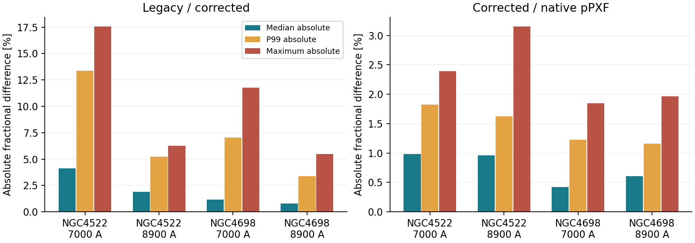
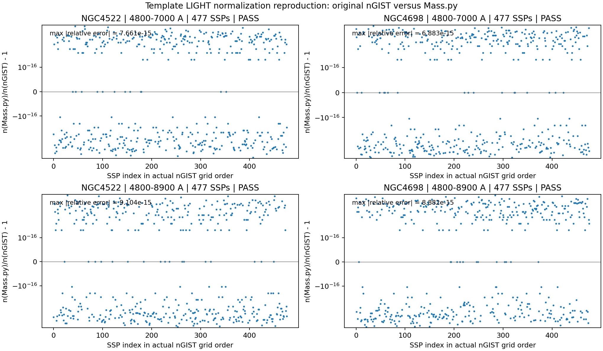
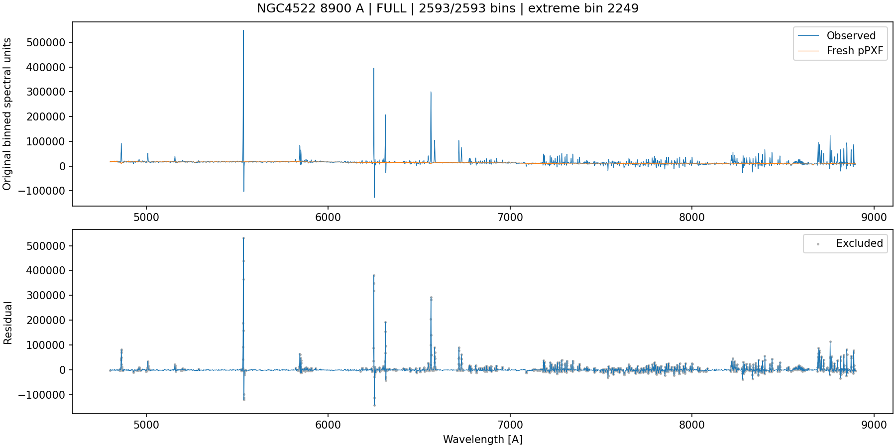
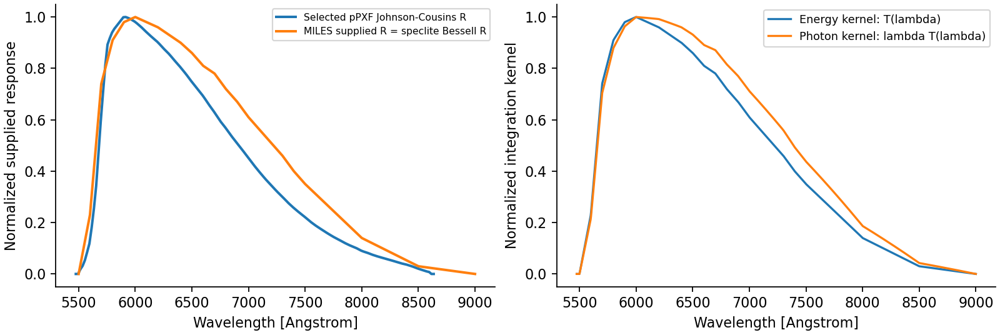
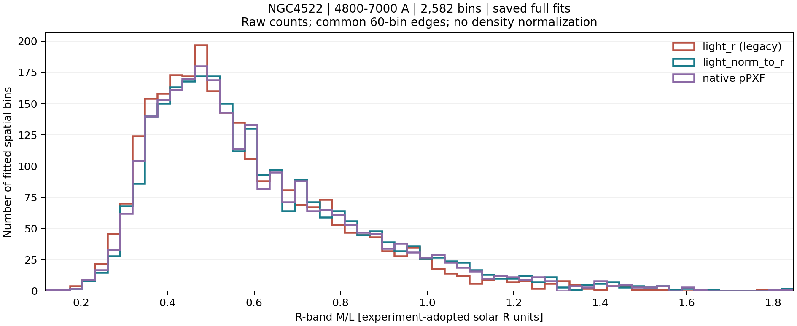
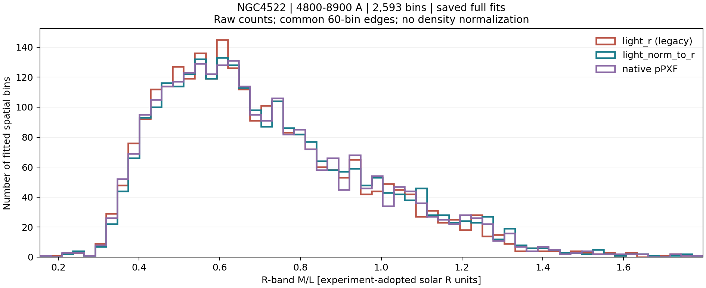
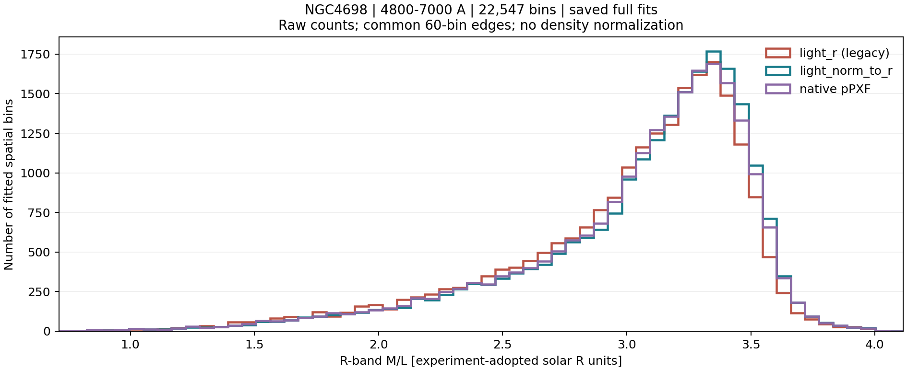
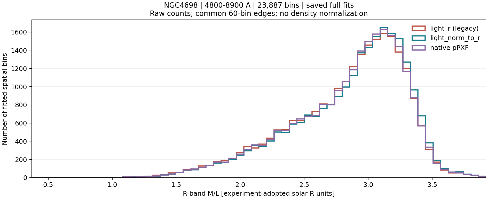

# MAUVE stellar M/L: three methods, template normalization, and R-band photometry

Detailed evidence report | Updated 1 November 2026 with raw-count M/L histograms and 1:1 scatter panels regenerated on Setonix from completed fits. Original fitting experiments: 31 October 2026. Targets: NGC4522 and NGC4698; existing 4800-7000 and 4800-8900 Angstrom configurations. This report consolidates the experiments and publisher-resource investigation. It supersedes provisional explanations where explicitly corrected below.

## 1. Main findings and current decision

The current light_norm_to_r reconstruction correctly reproduces the tested nGIST LIGHT template normalization. All 477 SSPs in each of four cases passed; prepared and normalized spectral samples matched exactly, and normalization-divisor differences were below 1e-14 relative. These residuals are floating-point effects, not a physical M/L error.

Treating the fitted coefficients as R-light fractions (legacy light_r) produces materially different resolved M/L values: the largest discrepancy from light_norm_to_r was 17.55%. Differences are smaller in the existing 8900-A configurations, but their different polynomial settings prevent a wavelength-only interpretation.

The actual native pPXF helper gives small residual differences from the corrected table route. Under the experiment's adopted mass/photometric conventions, their median signed differences are +0.42% to +0.98%, with a literal maximum of 3.15%. Saved-weight reconstruction accounts for these through the different SSP R luminosities. They do not indicate failure of Mass.py normalization.

The selected pPXF response is different from the R response supplied with the MILES SED product. The latter has samples exactly identical to installed speclite Bessell R. This identification is a numerical file comparison, not an explicit Bessell attribution in the MILES R-file header. Matching response samples alone does not match integration weighting or calibration.

Retain BaSTI+Chabrier.dat with light_norm_to_r for the current complete-grid analysis. The published SED-measurement table lacks R values for 74 of the 477 desired SSPs, so it is not a drop-in replacement. However, the separate surviving-mass table covers all 477 age-metallicity keys: missing R photometry must not be described as missing stellar masses. Retaining the current method is a practical choice, not proof that no alternative spectral method is possible.

| Established | Still unresolved |
| --- | --- |
| Normalization reproduction; actual fresh fits; measured deviations; supplied response arrays; publisher table identity | Exact effective calibration connecting current table M/L to cube luminosity; reasons for unavailable young SED R entries; young-age mass-file discrepancies |
| 51,609 successful fits; zero execution failures | Successful fits are not all independently certified science-quality populations |
| No production inputs or Mass.py changed by these experiments | No global luminosity-weighted M/L or final galaxy masses measured here |

<!-- PDF section break -->

## 2. Scientific question, targets, and scope

The experiment asks how much resolved R-band M/L changes when the same fresh SFH solution is interpreted in three ways. NGC4522 serves as the low-M/L target and NGC4698 as the high-M/L target. They were selected as contrasting practical cases for the experiment, with resolved population variation. This report does not independently re-rank the full sample or assert that every possible selection criterion makes them the absolute extrema.

The two existing fitting configurations are evaluated separately within each galaxy. No cross-range bin matching is performed. Each method within a case uses the same newly fitted weights; differences between methods are not differences between independent fits. The 7000/8900 runs also differ in MDEG (12/23), so configuration sensitivity is not a controlled test of wavelength coverage alone.

| Galaxy | Fit interval [A] | Successful bins | Failed bins | SSPs |
| --- | --- | --- | --- | --- |
| NGC4522 | 4800-7000 | 2582 | 0 | 477 |
| NGC4522 | 4800-8900 | 2593 | 0 | 477 |
| NGC4698 | 4800-7000 | 22547 | 0 | 477 |
| NGC4698 | 4800-8900 | 23887 | 0 | 477 |

The experiment uses nGIST products and SSP spectra on Setonix. It does not measure cube R photometry, use speclite in the three-method fit experiment, calculate final galaxy stellar masses, or derive flux-weighted global M/L. Those exclusions distinguish this experiment from the later discussion of the full Mass.py pipeline.

## 3. The three methods and their algebra

Let w_bj denote the saved LIGHT coefficient, n_j the divisor used by nGIST to normalize prepared template j, ell_Rj its table R luminosity, and Upsilon_Rj its table M/L. Any common normalization of weights within a bin cancels. The relative original-SSP coefficient is a_bj=w_bj/n_j; dividing, not multiplying, reverses the template rescaling.

$$
a_{bj}=w_{bj}/n_j
$$

Method 1, light_r: assume the fitted LIGHT coefficients are already R-band light fractions. This is the legacy interpretation, and is not appropriate in general for templates normalized by their mean prepared-spectrum flux.

$$
\Upsilon_{R,b}^{\mathrm{legacy}}=\frac{\sum_j w_{bj}\Upsilon_{R,j}}{\sum_j w_{bj}}
$$

Method 2, light_norm_to_r: restore each original SSP contribution, convert to its table R-light contribution, normalize those fractions, and average the SSP M/L. The luminosity proxy 10^(-0.4 M_Rj) is sufficient because a common zero point cancels in the fractions.

$$
q_{bj}=a_{bj}\ell_{R,j},\qquad \Upsilon_{R,b}^{\mathrm{corrected}}=\frac{\sum_j q_{bj}\Upsilon_{R,j}}{\sum_j q_{bj}}
$$

Method 3, native pPXF: run fresh pPXF SFH fits through the original nGIST sequence and call the actual unmodified pPXF SPS mass-to-light helper, after mapping the weights into its normalization. It obtains R luminosity by spectral photometry, using the explicitly selected response. The helper still needs model masses; pPXF does not infer those from spectral shape alone.

$$
\Upsilon_{R,b}^{\mathrm{native}}=\frac{\sum_j a_{bj}m_j}{\sum_j a_{bj}\ell_{R,j}^{\mathrm{spectral}}}
$$

For this completed experiment the supplied masses were reconstructed from the matched BaSTI/Chabrier table, rather than from a generic pPXF SPS download with a different IMF/isochrone choice. It is an actual native-helper experiment with shared assumed masses, not an independent absolute stellar-mass calibration.

<!-- PDF section break -->

## 4. Execution and resolved M/L values

The 36-fit pilot (Slurm 51895504) completed without failures. The full execution (51895534) completed all 51,609 bins with zero failures in approximately 4 h 53 min. The separate complete SSP-photometry notebook (51925460) completed with exit 0:0 in 45 s wall time. Production pPXF was 9.4.5; Python 3.11.15, NumPy 1.26.4, SciPy 1.17.1, and Astropy 7.2.0. The notebooks record source/template hashes and detailed manifests.

The following are medians across resolved fitted bins, in the experiment's adopted solar-band units. They are included to give the M/L scale of the two targets. They must not be called global or integrated galaxy M/L values.

| Galaxy | Upper fit limit [A] | Median light_r | Median corrected | Median native |
| --- | --- | --- | --- | --- |
| NGC4522 | 7000 | 0.520451 | 0.543157 | 0.537559 |
| NGC4522 | 8900 | 0.655371 | 0.671065 | 0.664569 |
| NGC4698 | 7000 | 3.124390 | 3.175973 | 3.159834 |
| NGC4698 | 8900 | 2.929169 | 2.957597 | 2.938872 |

A true integrated value requires the appropriate stellar R luminosity for each bin and an identical spatial footprint: Upsilon_global=sum_b(M_b)/sum_b(L_Rb). A median of resolved M/L is not this estimator. This experiment therefore does not answer the earlier request for numerical global M/L or final stellar masses.

## 5. Legacy light_r versus corrected light_norm_to_r

Define the signed difference as 100*(light_r/light_norm_to_r - 1). Negative values mean the legacy interpretation gives smaller M/L. Statistics below count each successful bin once. Median absolute and tail statistics were independently recalculated from the downloaded bin_results.csv files.

| Galaxy | Limit [A] | Median signed [%] | Median abs. [%] | P99 abs. [%] | Max abs. [%] | Worst BINID |
| --- | --- | --- | --- | --- | --- | --- |
| NGC4522 | 7000 | -4.1241 | 4.1241 | 13.3597 | 17.5524 | 464 |
| NGC4522 | 8900 | -1.9173 | 1.9173 | 5.2364 | 6.2577 | 207 |
| NGC4698 | 7000 | -1.1769 | 1.1769 | 7.0311 | 11.7622 | 22223 |
| NGC4698 | 8900 | -0.7926 | 0.7926 | 3.3881 | 5.4599 | 14455 |

The largest legacy discrepancy is 17.5524% in NGC4522, 7000-A BINID 464. NGC4698 also reaches 11.7622% in its 7000-A case. Thus the LIGHT-to-R conversion matters especially for mixed populations, even where a galaxy's median discrepancy is modest. The existing longer-range configurations reduce the legacy discrepancy distribution for both galaxies.

Figure 1. Resolved-bin absolute percentage differences. The two panels have different vertical scales. Median absolute, P99 absolute, and literal maxima convey typical and extreme behavior without conflating either with a galaxy mass correction.

<!-- PDF section break -->

## 6. Direct reproduction of nGIST template normalization

The actual original nGIST preparation functions were compared with functions extracted from the tested Mass.py, including prepared wavelength sampling, padding, LSF treatment, and LIGHT normalization. Every case covers all 477 SSPs, not one representative bin. Galaxy and template velocity scales were 41.0 and 20.5 km/s. Prepared grids contained 6292 pixels for 7000 A and 9738 for 8900 A.

| Galaxy | Limit [A] | Max relative divisor difference | Prepared sample max difference | Normalized sample max difference | Status |
| --- | --- | --- | --- | --- | --- |
| NGC4522 | 7000 | 7.661e-15 | 0 | 0 | PASS |
| NGC4698 | 7000 | 6.883e-15 | 0 | 0 | PASS |
| NGC4522 | 8900 | 9.104e-15 | 0 | 0 | PASS |
| NGC4698 | 8900 | 8.882e-15 | 0 | 0 | PASS |

Figure 2. Original nGIST versus Mass.py preparation, reproduced for both galaxies and both fit configurations. Differences in mean divisors remain at floating-point roundoff; prepared and normalized sample arrays match exactly in these checks.

The maximum relative divisor discrepancy is 9.10e-15. The original 7.66e-15 result was for NGC4522 at 7000 A only; the four-case result is the appropriate complete statement. Spectral equality is exact for the arrays tested, while divisor reduction order produces tiny floating-point differences. This verifies these configurations and this software stack; it is not a universal guarantee for every historical environment or future template library.

A reference-divisor table-control M/L agreed with light_norm_to_r to approximately 5.2e-15 relative in saved results. A separate saved-weight audit reconstructed table and native M/L to better than 3e-13 relative after reading diagnostic CSVs. These tests establish the normalization/algebra, not the physical accuracy of the assumed SSP masses, calibration, attenuation, or the final cube luminosity.

<!-- PDF section break -->

## 7. Why corrected and native pPXF M/L remain different

Define the signed difference as 100*(light_norm_to_r/ppxf_native - 1). Under the experiment's shared reconstructed masses, the numerator is the same mass mixture but the denominator uses different SSP R luminosities. Therefore the corrected/native ratio is the spectral/table luminosity ratio of the mixture.

$$
\frac{\Upsilon_R^{\mathrm{corrected}}}{\Upsilon_R^{\mathrm{native}}}=\frac{\sum_j a_j\ell_{R,j}^{\mathrm{spectral}}}{\sum_j a_j\ell_{R,j}^{\mathrm{table}}}
$$

| Galaxy | Limit [A] | Median signed [%] | Median abs. [%] | P99 abs. [%] | Max abs. [%] | Worst BINID |
| --- | --- | --- | --- | --- | --- | --- |
| NGC4522 | 7000 | +0.9815 | 0.9815 | 1.8248 | 2.3945 | 1069 |
| NGC4522 | 8900 | +0.9608 | 0.9610 | 1.6217 | 3.1494 | 2249 |
| NGC4698 | 7000 | +0.4248 | 0.4255 | 1.2253 | 1.8423 | 22460 |
| NGC4698 | 8900 | +0.6029 | 0.6029 | 1.1563 | 1.9650 | 23364 |

The median native comparison changes little with the fitting configuration for NGC4522 and increases for NGC4698. The literal maxima are larger at 8900 A for both. There is no universal finding that a longer fitting range brings the corrected/native comparison closer. The primary legacy bias and the secondary photometric offset are distinct effects.

NGC4522 8900-A BINID 2249, which gives the largest corrected/native difference (3.1494%), has post-fit S/N about 10.6 and conspicuous artifacts in its diagnostic spectrum. It remains in the reported literal maximum, but should not be presented as an independently certified high-quality population measurement. P99 statistics reduce dependence on individual extreme bins; no post-hoc S/N cut has been applied.

Figure 3. Diagnostic fit for the literal maximum corrected/native discrepancy, NGC4522 8900-A BINID 2249. Fit completion is distinct from scientific quality; the accompanying artifacts motivate reporting robust tails as well as maxima.

<!-- PDF section break -->

## 8. Which R response did pPXF use?

Our notebook explicitly requested REST_FRAME/Johnson-Cousins_R.dat in Vega mode; pPXF did not automatically choose a response based on the SSP library or table. In the Setonix pPXF 9.4.5 source, read_filter reads that named block from examples/FILTER.RES.txt. The selected response has 159 samples over 5475-8635 A. mag_spectrum compares the source and the bundled Vega spectrum through synthetic_photometry; its kernel includes wavelength, giving photon weighting.

$$
\langle F_\lambda\rangle_R=\frac{\int F_\lambda(\lambda)T_R(\lambda)\lambda\,d\lambda}{\int T_R(\lambda)\lambda\,d\lambda}
$$

The R_Cousins block linked from the official MILES SED-photometry page contains 24 samples spanning 5500-9000 A. Its sample wavelengths and responses match installed speclite bessell-R exactly. Speclite explicitly attributes this curve to Table 2 of Bessell (1990). The MILES block itself is labelled R_Cousins and does not explicitly cite Bessell there. The statement that the curves are identical is our direct numerical comparison of publisher-supplied data, not a quotation from a MILES paper [1-3].

Figure 4. Left: the different supplied pPXF and MILES/speclite R response curves. Right: energy and photon kernels built from the same MILES response samples. Identical tabulated curves need not give identical photometry if integration weighting differs.

Consequently the original small native offset cannot be assigned solely to normalization or solely to response choice. Response shape, weighting, Vega reference/zero point, and photometric-library versus spectral predictions all matter. An AB/Vega system label alone is insufficient to define the complete operator.

<!-- PDF section break -->

## 9. SSP diagnostic notebook: numerical and library checks

The second notebook compares absolute SSP magnitudes at 10 pc, before introducing stellar masses or a solar R magnitude. It uses the same 477 spectra, an independent piecewise-linear/Simpson integrator, direct reproduction of the native sampled-grid formula, log-rebin tests, response/reference alternatives, and V/I controls. No SFH refits or cube photometry are needed.

| Check | Maximum discrepancy | Interpretation |
| --- | --- | --- |
| Safe versus corresponding original spectrum | 0 for all 477 spectra | No changed spectral arrays in the safe copies |
| pPXF versus explicit native sampled formula | 1.78e-15 mag | Native calculation reproduced |
| pPXF versus independent integration | 1.52e-5 mag | Quadrature differences negligible here |
| Raw versus log-rebinned R magnitude | 3.84e-8 mag | Sampling does not explain percent-level offsets |

Under the original pPXF-response baseline, median spectral-minus-table R is -0.011151 mag; P95 absolute is 0.029509 mag and maximum absolute 0.044000 mag. The corresponding SSP spectral/table R flux differences span -1.546% to +4.136%, with median +1.032%. These are individual-SSP diagnostics, not the resolved-bin percentages in Section 7.

Residuals vary with age and metallicity, so one constant zero-point adjustment cannot remove them. V is much closer to a constant offset: its P95 absolute residual after median removal is 0.000482 mag, versus 0.021972 mag for R. This suggests a calibration component plus population-dependent color differences; it does not identify a unique physical cause.

Figure 5. Left: population-dependent residuals under the original pPXF-response comparison. Right: newly retrieved publisher response and CALSPEC reference reproduce the 403 valid publisher SED R values to a nearly constant 0.000512-mag offset. The panels intentionally use different vertical scales.

<!-- PDF section break -->

## 10. Two MILES tables: provenance and incomplete SED photometry

The earlier lack of publisher metadata was resolved by locating the current working official pages [1,2]. These distinguish predictions based on photometric stellar libraries from photometry measured on E-MILES SEDs. The local BaSTI+Chabrier.dat matches official out_phot_CH_BASTI in every data token, 636 rows by 34 columns. This establishes which publisher product our current table is.

| Property | Photometric predictions | SED measurements |
| --- | --- | --- |
| Local file | BaSTI+Chabrier.dat | UBBVRIJHK_ch_iTp0.00.MAG |
| Origin | Empirical photometric-library relations | Photometry measured from SSP spectra |
| Vega R zero point | 0.03 mag | 0.00 mag |
| Direct surviving-mass column | Not included | M(*+remn) included |
| Full-file dimensions | 636 x 34 | 636 x 23 |
| R availability for fitted 477 SSPs | All 477 | 403 valid; 74 unavailable (-99) |

The official SED page specifies CALSPEC alpha_lyr_stis_008.fits as its Vega reference and solar R magnitude 4.459 [2]. The latter is also consistent with the solar V-R color inferred from the original table's V/R M/L and magnitude columns, using the model paper's solar V=4.82 [4]. Do not transfer a Vega magnitude directly into an AB conversion.

A bounded follow-up integration used the official response and CALSPEC reference on all 477 actual SSP spectra. Among 403 valid published R values, energy weighting gave median recomputed-minus-publisher magnitude +0.00051161, with maximum residual after median removal 5.45e-6 mag. Photon weighting instead gave median -0.02143279 mag and maximum absolute 0.02705971 mag. This is empirical reproduction of the published calculation, not an explicit energy-weighting statement found on the page.

Adding the documented +0.03 R zero point to the energy-weighted magnitudes brings the median difference from the original photometric table to +0.00001417 mag, but P95 absolute remains 0.02046175 mag and maximum absolute 0.03236390 mag. Thus the zero-point difference explains an overall shift, not every population-dependent residual. The model authors separately compare photometric-library and spectral colors and discuss small residual differences [5,6].

The 74 unavailable R predictions in the fitted subset occur at ages 0.03-0.25 Gyr; the full 636-row SED table has 105 unavailable R entries. Treat -99 as unavailable, not as a physical magnitude or M/L. The exact reason for these omissions has not been established. Computing an integral from an available spectrum is possible, but does not alone certify the omitted broadband prediction as reliable. Do not drop these fitted SSPs merely to make a replacement table complete.

<!-- PDF section break -->

## 11. Surviving masses are available: a necessary distinction

The official photometric-library page also supplies out_mass_CH_BASTI, separately from either R-photometry table [1]. It contains total initial mass, living stars plus remnants, living stars, remnants, returned gas, V-band M/L, and V magnitude; its normalization is initially one solar mass. Its M(*+remn) values cover all 477 fitted age-metallicity identities. The incomplete R columns in the SED table therefore do not mean that matching mass entries are absent.

There are small inconsistencies worth preserving rather than hiding. The SED table's mass column differs from the separate mass table for 27 SSPs at 0.06, 0.08, and 0.09 Gyr, by up to about 1.19% relative to the separate mass-file value. Their version provenance needs clarification before silently substituting one mass array for another.

Reconstructing masses from the original table's R magnitude and M/L with solar R=4.459 gives median relative difference -0.00526% and maximum absolute 0.59650% from the separate publisher mass grid. Allowing half a printed step in both magnitude and M/L encloses 476/477 masses. The remaining case, age 0.30 Gyr and [M/H]=-1.49, gives direct mass 0.7068 versus reconstructed 0.704618 solar masses. This small inconsistency remains documented.

The completed three-method experiment instead adopted a pPXF-derived solar R magnitude about 4.432816 to reconstruct its shared mass grid. Replacing that adopted value by 4.459 increases those reconstructed masses by factor 1.0244095. This qualifies the experiment's absolute mass calibration; it is not a factor to apply blindly to the current Mass.py galaxy mass maps. The earlier normalization test is unaffected.

## 12. Zero points and the present final-mass calculation

A common SSP magnitude offset multiplies every q_bj by the same factor and cancels in the normalized R-light fractions. Thus no separate subtraction of 0.03 mag is required when constructing those fractions. For observed solar-band luminosity, the object and Sun must share a photometric convention:

$$
L_R/L_{R,\odot}=10^{-0.4(M_R-M_{R,\odot})}
$$

An equal zero-point shift in both magnitudes cancels. A solar-band luminosity convention also cancels from final mass if M/L and observed luminosity are both consistently re-expressed. It does not cancel if a tabulated M/L is held fixed while only the observed luminosity scale is changed.

Current Mass.py combines table SSP M/L, speclite bessell-R AB cube photometry, an adopted solar AB R magnitude 4.61, and an internal attenuation correction. Do not replace 4.61 by the publisher's Vega 4.459 without changing the rest of the conversion. The remaining calibration task is to quantify the exact effective-band/solar-scale link, rather than assume all conventions cancel because both products are called R. These experiments have not demonstrated that the current final-mass calibration is exact, nor that the table-based estimator is invalid.

<!-- PDF section break -->

## 13. Recommended interpretation and next steps

For current complete-grid work, retain BaSTI+Chabrier.dat and the validated light_norm_to_r branch. The published spectral-measurement table is useful for independent checks but cannot directly replace the prediction table across the desired SSP grid. This decision avoids silently discarding 74 SSPs or inventing R values for unavailable entries. It is a practical choice, not a logical requirement imposed by missing masses.

A future spectral implementation can use a pinned matching surviving-mass array and one identical operator for model and observed stellar light. For a mixture with a_j=w_j/n_j, construct model mass sum(a_j m_j) and model R luminosity P[sum(a_j s_j)]. Scale its mass by observed/model R luminosity:

$$
M_{\star,b}=\frac{L_{R,b}^{\mathrm{observed}}}{\mathcal{P}[\sum_j a_{bj}s_j]}\sum_j a_{bj}m_j
$$

This can be evaluated in physical units without solar or Vega magnitudes. If reporting solar-unit M/L, introduce the same solar operator consistently. It is not sufficient to multiply the existing native-pPXF R M/L by current speclite cube luminosity, because the operators differ. Keeping Bessell R is reasonable; the chosen weighting must be explicit and common.

An end-to-end validation must also align stellar versus emission-contaminated light, foreground/internal attenuation, observed versus rest wavelength, distance, spatial footprint, and AO gaps or masked samples. Either use the same effective spectral operator on model and data or document a model-based correction to a complete band. The 7000-A fit may predict a complete R band using the full SSP spectra; the luminosity integral should not be truncated automatically at the fitting limit. Unconstrained multiplicative continuum polynomials are not automatically physical dust attenuation.

No new fit run is required merely to identify response or calibration conventions. If an alternative mass/luminosity conversion is developed, compare it on saved weights first and keep the current production estimator unchanged until the young-SSP coverage, mass-version choice, and observed-light calibration are resolved.

## 14. Corrections to provisional conversational claims

| Provisional wording | Supported final statement |
| --- | --- |
| MILES explicitly says it uses our Bessell R | The supplied MILES SED R samples match speclite Bessell R; identification was tested, not quoted from the R-file header. |
| The two MILES tables use different R responses | Different prediction methods and zero points are established; different exact response curves for the photometric-library table are not. |
| Matching stellar masses are unavailable | A matching publisher mass grid is available; some mass columns disagree at young ages. |
| Missing SED values mean we must always use predictions | They prevent a direct full-grid SED-table substitution; a separately validated spectral calculation remains possible. |
| Native pPXF and corrected M/L must agree exactly | They agree algebraically only when masses, luminosity operators, units and normalizations match. |
| The normalization test proves the final masses | It validates template preparation and coefficient conversion; final observed luminosity calibration is a separate question. |

<!-- PDF section break -->

## 15. Raw M/L histograms and pairwise 1:1 scatter plots

Added at the user's request. The earlier notebook already included pairwise scatter and signed-difference histograms, but the report did not show them and the three overlaid absolute-M/L distributions were absent. The notebook now produces dedicated raw-count histograms and readable 1:1 scatter figures for every galaxy/range case. These views complement Figure 1's percentage statistics.

## 15.1. NGC4522, 4800-7000 Angstrom: 2,582 fitted bins

The three histograms use identical 60-bin edges spanning their combined full M/L range. The vertical axis is the number of fitted spatial bins, with no area or density normalization. All three curves describe exactly the same successful bins. Close overlap is expected where the differences are small; it does not imply numerical identity. The scatter panels plot every bin, without subsampling or clipping, using equal x/y limits and aspect within each panel.

Figure 6. NGC4522, 4800-7000 A. Overlaid raw-count M/L distributions. Common edges allow count-by-count comparison within this galaxy and fitting range; distribution amplitudes should not be compared as galaxy luminosity or mass.

Figure 7. NGC4522, 4800-7000 A. Pairwise M/L scatter with dashed 1:1 lines. The first panel places legacy on y and corrected on x; the second corrected on y and native on x; the third legacy on y and native on x. Annotations use 100*(y/x-1), matching the report's ratio directions. Equal axis scales make systematic offsets from equality visible.

<!-- PDF section break -->

## 15.2. NGC4522, 4800-8900 Angstrom: 2,593 fitted bins

The three histograms use identical 60-bin edges spanning their combined full M/L range. The vertical axis is the number of fitted spatial bins, with no area or density normalization. All three curves describe exactly the same successful bins. Close overlap is expected where the differences are small; it does not imply numerical identity. The scatter panels plot every bin, without subsampling or clipping, using equal x/y limits and aspect within each panel.

Figure 8. NGC4522, 4800-8900 A. Overlaid raw-count M/L distributions. Common edges allow count-by-count comparison within this galaxy and fitting range; distribution amplitudes should not be compared as galaxy luminosity or mass.

Figure 9. NGC4522, 4800-8900 A. Pairwise M/L scatter with dashed 1:1 lines. The first panel places legacy on y and corrected on x; the second corrected on y and native on x; the third legacy on y and native on x. Annotations use 100*(y/x-1), matching the report's ratio directions. Equal axis scales make systematic offsets from equality visible.

<!-- PDF section break -->

## 15.3. NGC4698, 4800-7000 Angstrom: 22,547 fitted bins

The three histograms use identical 60-bin edges spanning their combined full M/L range. The vertical axis is the number of fitted spatial bins, with no area or density normalization. All three curves describe exactly the same successful bins. Close overlap is expected where the differences are small; it does not imply numerical identity. The scatter panels plot every bin, without subsampling or clipping, using equal x/y limits and aspect within each panel.

Figure 10. NGC4698, 4800-7000 A. Overlaid raw-count M/L distributions. Common edges allow count-by-count comparison within this galaxy and fitting range; distribution amplitudes should not be compared as galaxy luminosity or mass.

Figure 11. NGC4698, 4800-7000 A. Pairwise M/L scatter with dashed 1:1 lines. The first panel places legacy on y and corrected on x; the second corrected on y and native on x; the third legacy on y and native on x. Annotations use 100*(y/x-1), matching the report's ratio directions. Equal axis scales make systematic offsets from equality visible.

<!-- PDF section break -->

## 15.4. NGC4698, 4800-8900 Angstrom: 23,887 fitted bins

The three histograms use identical 60-bin edges spanning their combined full M/L range. The vertical axis is the number of fitted spatial bins, with no area or density normalization. All three curves describe exactly the same successful bins. Close overlap is expected where the differences are small; it does not imply numerical identity. The scatter panels plot every bin, without subsampling or clipping, using equal x/y limits and aspect within each panel.

Figure 12. NGC4698, 4800-8900 A. Overlaid raw-count M/L distributions. Common edges allow count-by-count comparison within this galaxy and fitting range; distribution amplitudes should not be compared as galaxy luminosity or mass.

Figure 13. NGC4698, 4800-8900 A. Pairwise M/L scatter with dashed 1:1 lines. The first panel places legacy on y and corrected on x; the second corrected on y and native on x; the third legacy on y and native on x. Annotations use 100*(y/x-1), matching the report's ratio directions. Equal axis scales make systematic offsets from equality visible.

The plotting refresh re-executed only the new helper and saved-results plotting cells in the production Setonix environment. It did not rerun SFH fits, template preparation, or the existing analysis. All input bin_results.csv hashes and earlier notebook outputs were preserved. Saved histogram-count CSVs confirm that every method's count sum equals the successful-bin total; plot_refresh_20261101.json records provenance. Original and refreshed notebook versions are archived separately.

<!-- PDF section break -->

## 16. Delivered notebooks and reproducibility inventory

Both authoritative executed notebooks are local under /Users/Igniz/Desktop/ICRAR/further. The three-method source and executed notebook were updated and copied back from Setonix after the plotting refresh on 1 November 2026; the photometry notebook is unchanged. Local and remote SHA-256 checksums match. Fresh nbformat validation found zero error outputs in each: 31 cells for the updated three-method notebook and 22 for the SSP-photometry notebook. These are the files to open for completed outputs:

/Users/Igniz/Desktop/ICRAR/further/20261031_SETONIX_MAUVE_ML_Three_Methods_full_executed.ipynb

SHA-256: ba45313ef7a71e3bd98abc839d0922458e53e67178670327180dc348d1bfc2c1

/Users/Igniz/Desktop/ICRAR/further/20261031_SETONIX_MAUVE_SSP_R_Photometry_Check_executed.ipynb

SHA-256: 2e7ccd77c324512c946c5cb6abf96511c205e7406aa13bde448902a6f944f514

The corresponding unsuffixed notebooks are editable source versions. The Three_Methods_pilot_executed notebook records the 36-fit pilot; it is not the full final result. Do not delete the source or pilot merely because the full execution is authoritative.

Main local result directories: /Users/Igniz/Desktop/ICRAR/further/20261031_MAUVE_ML_Three_Methods_results and /Users/Igniz/Desktop/ICRAR/further/20261031_MAUVE_SSP_R_Photometry_results. The three-method directory contains combined summaries, normalization checks, per-case bin_results.csv, summary.json, manifests, maps and worst-bin figures. Large HDF5 checkpoints, matched SPS NPZ and output FITS maps remain on Setonix.

Remote experiment directories: /scratch/pawsey1308/rhuang/mauve_ml_three_methods_20261031/d331b6665d204432/ and /scratch/pawsey1308/rhuang/ssp_r_photometry_check_20261031/b99e0c44a7b996a2/. The publisher response/CALSPEC follow-up ran separately in /home/rhuang/mauve_publisher_photometry_check/.

The official SED table is also directly available at /Users/Igniz/Desktop/ICRAR/further/UBBVRIJHK_ch_iTp0.00.MAG. Publisher files, URL/hash manifest, publisher_mass_and_SED_crosscheck.csv and publisher_response_calspec_crosscheck.csv are in the photometry result directory. The original executed notebooks retain their historical adopted assumptions; this report records subsequent publisher discoveries without rewriting the execution record.

## 17. Sources and evidence attribution

[1] MILES Team: predicted masses and photometric observables based on photometric libraries. Source of local-table identity, Vega offsets, mass definitions and linked BaSTI/Chabrier files. <https://research.iac.es/proyecto/miles/pages/predicted-masses-and-photometric-observables-based-on-photometric-libraries.php>

[2] MILES Team: photometric predictions based on E-MILES SEDs. Source of spectral table, response file, CALSPEC reference and adopted solar magnitudes. <https://research.iac.es/proyecto/miles/pages/photometric-predictions-based-on-e-miles-seds.php>

[3] Speclite documentation: Johnson/Cousins filters, attributed to Bessell (1990), Table 2. <https://speclite.readthedocs.io/en/latest/filters.html#johnson-cousins-filters>

[4] Vazdekis et al. (2015), MILES II: BaSTI ingredients, empirical photometric transformations and adopted solar V calibration. <https://arxiv.org/html/1504.08032>

[5] Vazdekis et al. (2012), MIUSCAT I, Section 3/Figure 8: separate photometric-library and spectral color predictions and their residuals. <https://arxiv.org/html/1205.5496>

[6] Vazdekis et al. (2016), E-MILES: empirical photometric transformations, spectrum normalization, and synthetic-versus-photometric color checks. <https://arxiv.org/html/1612.01187>

[7] Falcon-Barroso et al. (2011), updated MILES library and models, Section 3.2: spectrum absolute-flux calibration and independent photometric predictions. <https://arxiv.org/html/1107.2303>

Numerical results, source-function behavior, file equality, and coverage counts are measurements from the supplied notebooks and local/Setonix artifacts, not literature claims. The official website was reachable during resource retrieval but intermittently timed out on later requests; downloaded files and SHA-256 provenance are preserved. This report was prepared with Codex-assisted source inspection, numerical verification, writing, and rendering. The notebook plotting code was updated and executed on completed results; no new SFH fitting or production-pipeline code modification was performed for this update.
