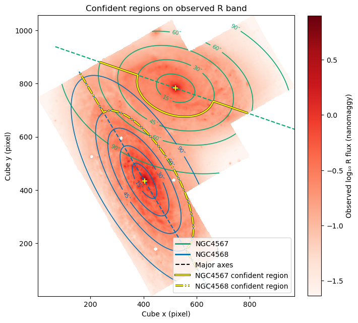
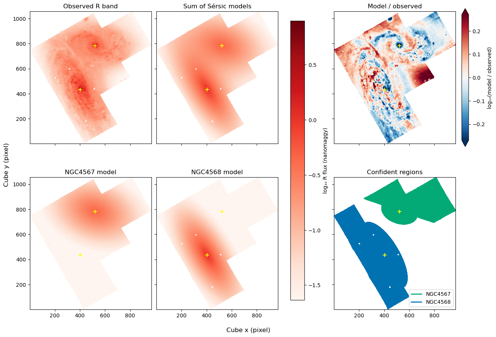
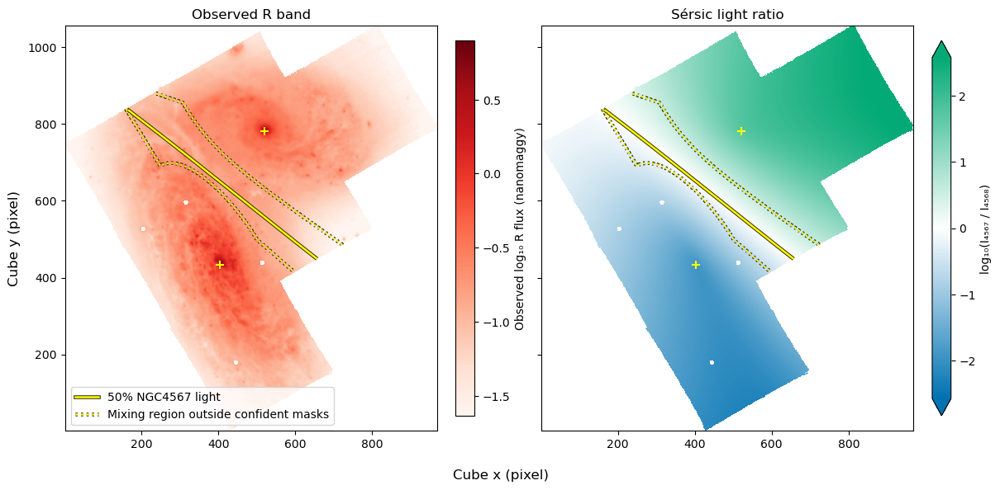

# 20261111 Separate NGC4567 and NGC4568

We define the confident regions of NGC4567 and NGC4568 by their major axis and 60'' and 30'' radius, respectively. 

Then we fit the sersic profiles to them, and the fitting $R^2$ of NGC4567 and NGC4568 are 0.47 and 0.70. 

And then we can define the unmixed regions by at least 80% of observed light coming from either NGC4567 or NGC4568; while for the rest will be the mixing region that we can get rid of (dashed lines). 

