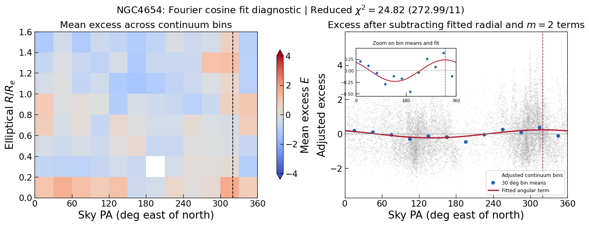
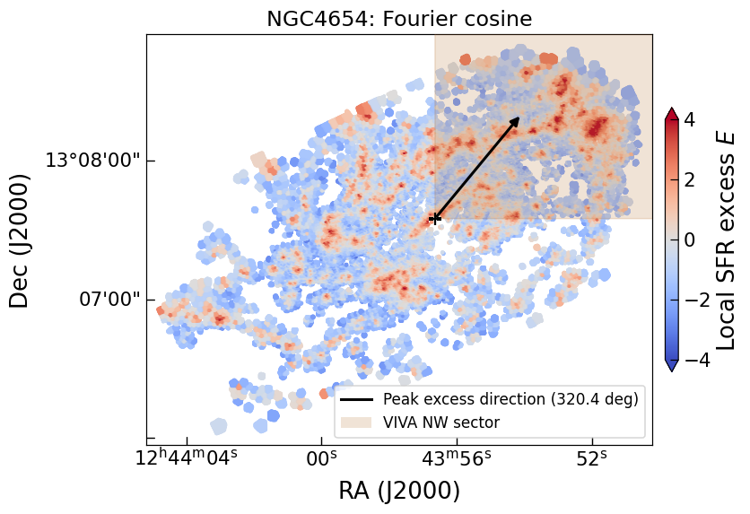
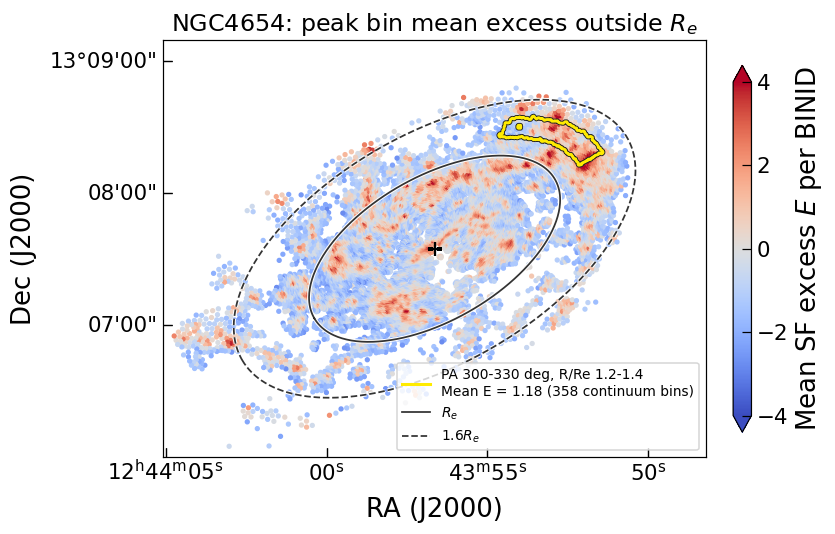
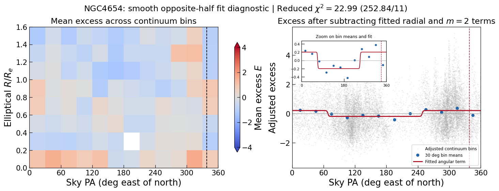
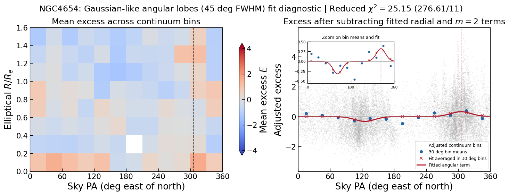
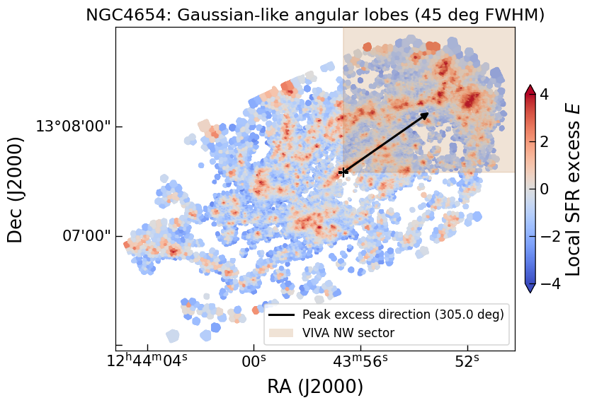
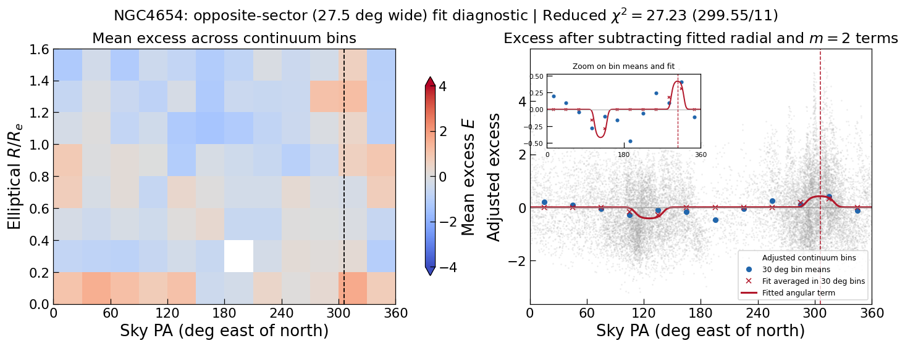
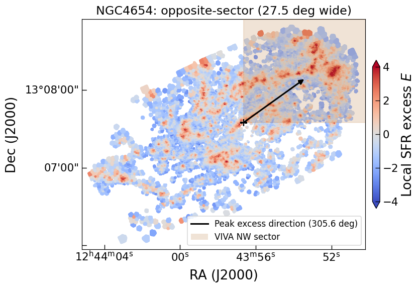
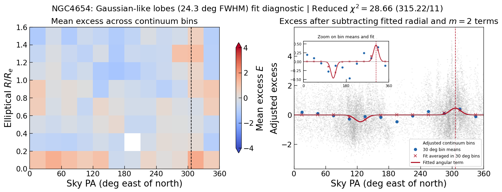
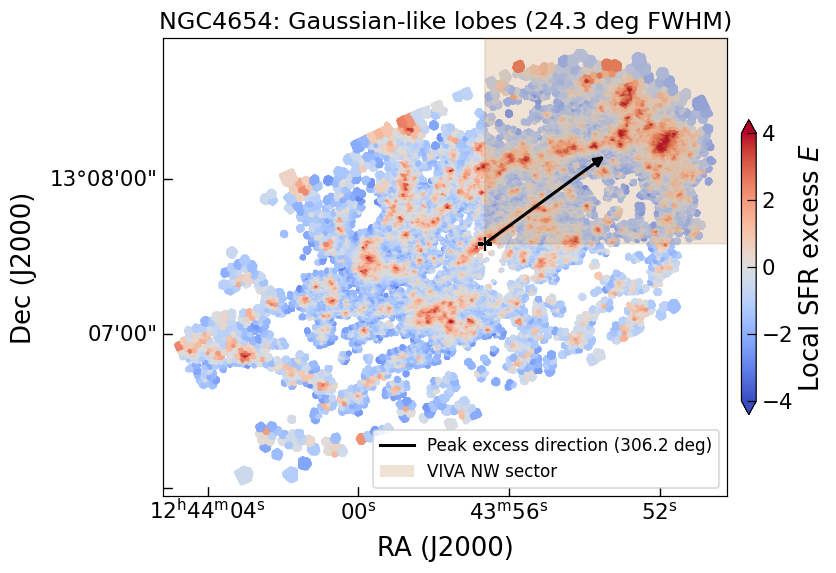

# 20261117 GM Skyfall

Now we want to try different $m=1$ component to do the Fourier decomposition fit with the local SFR excess map of NGC4654. 

## 1. Sine/Cosine mode

$$
\begin{aligned}
\widehat E_i={}&\underbrace{\alpha_a+\beta_a(r_i-r_a)}_{m=0}+\underbrace{c_1\cos\phi_i+s_1\sin\phi_i}_{m=1}\\
&+\underbrace{c_{2,a}\cos(2\phi_i)+s_{2,a}\sin(2\phi_i)}_{m=2},\\
\end{aligned}
$$

## 2. Smooth opposite-half

$$
\begin{aligned}
\widehat E_i
={}&\underbrace{\alpha_a+\beta_a(r_i-r_a)}_{m=0}
+\underbrace{A\,\frac{\tanh[\kappa\cos(\phi_i-\theta)]}{\tanh\kappa}}_{\text{opposite-half term}}\\
&+\underbrace{c_{2,a}\cos(2\phi_i)+s_{2,a}\sin(2\phi_i)}_{m=2}.
\end{aligned}
$$

Note that it reduces to Sine/Cosine mode if $\kappa=0$.

## 3. Smooth opposite-sector with $45^\circ$ sector width

$$
\begin{aligned}
\widehat E_i
={}&\underbrace{\alpha_a+\beta_a(r_i-r_a)}_{m=0}
+\underbrace{A\,\frac{h_{\rm sec}(u_i;w,\kappa)}{h_{\rm sec}(1;w,\kappa)}}_{\text{opposite-sector term}}\\
&+\underbrace{c_{2,a}\cos(2\phi_i)+s_{2,a}\sin(2\phi_i)}_{m=2}.
\end{aligned}
$$

where

$$
\begin{aligned}
u_i &= \cos(\phi_i-\theta),\\
h_{\rm sec}(u;w,\kappa)
&=\tfrac12\left[
\tanh\!\bigl(\kappa[u-\cos(w/2)]\bigr)
-\tanh\!\bigl(\kappa[-u-\cos(w/2)]\bigr)
\right].
\end{aligned}
$$

Here \(w=45^\circ\) 

## 4. Smooth Gaussian-like angular lobes with $45^\circ$ FHWM

$$
\begin{aligned}
\widehat E_i
={}&\underbrace{\alpha_a+\beta_a(r_i-r_a)}_{m=0}
+\underbrace{A\,\frac{\sinh(\kappa_{45}\cos(\phi_i-\theta))}{\sinh\kappa}}_{\text{opposite-lobe term}}\\
&+\underbrace{c_{2,a}\cos(2\phi_i)+s_{2,a}\sin(2\phi_i)}_{m=2}.
\end{aligned}
$$

Here
$$
\kappa_{45}=\frac{\ln 2}{1-\cos(45^\circ/2)}.
$$

## 5. Smooth opposite-sector with free sector width

$$
\begin{aligned}
\widehat E_i
={}&\underbrace{\alpha_a+\beta_a(r_i-r_a)}_{m=0}
+\underbrace{A\,\frac{h_{\rm sec}(u_i;w,\kappa)}{h_{\rm sec}(1;w,\kappa)}}_{\text{opposite-sector term}}\\
&+\underbrace{c_{2,a}\cos(2\phi_i)+s_{2,a}\sin(2\phi_i)}_{m=2}.
\end{aligned}
$$

$$
\begin{aligned}
u_i &= \cos(\phi_i-\theta),\\
h_{\rm sec}(u;w,\kappa)
&=\tfrac12\left[
\tanh\!\bigl(\kappa[u-\cos(w/2)]\bigr)
-\tanh\!\bigl(\kappa[-u-\cos(w/2)]\bigr)
\right].
\end{aligned}
$$

Here \(w\) is free

## 6. Smooth Gaussian-like angular lobes with free FHWM

$$
\begin{aligned}
\widehat E_i
={}&\underbrace{\alpha_a+\beta_a(r_i-r_a)}_{m=0}
+\underbrace{A\,\frac{\sinh(\kappa\cos(\phi_i-\theta))}{\sinh\kappa}}_{\text{opposite-lobe term}}\\
&+\underbrace{c_{2,a}\cos(2\phi_i)+s_{2,a}\sin(2\phi_i)}_{m=2}.
\end{aligned}
$$

At each trial FWHM \(w\), compute \(\kappa(w)\) from
$$
\frac{\sinh[\kappa(w)\cos(w/2)]}{\sinh\kappa(w)}=\frac12,
\qquad 5^\circ\le w\le120^\circ.
$$

