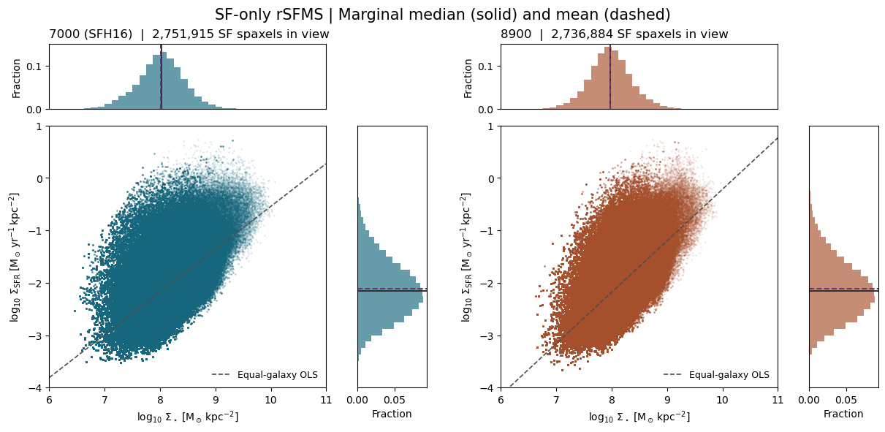
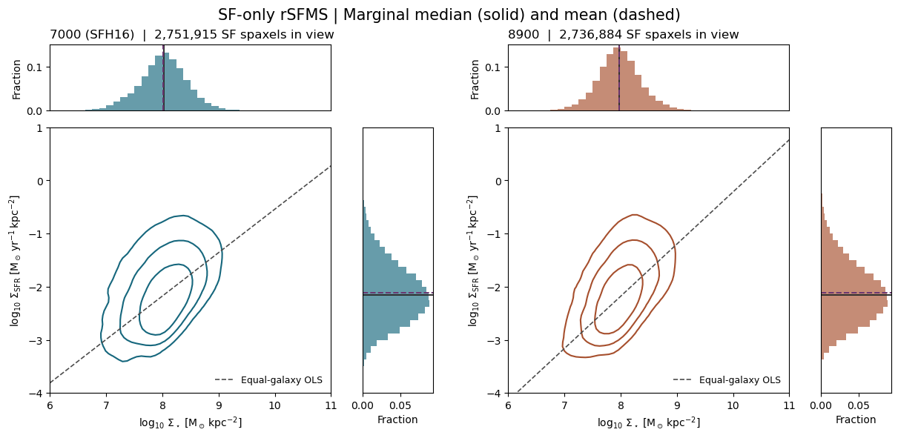
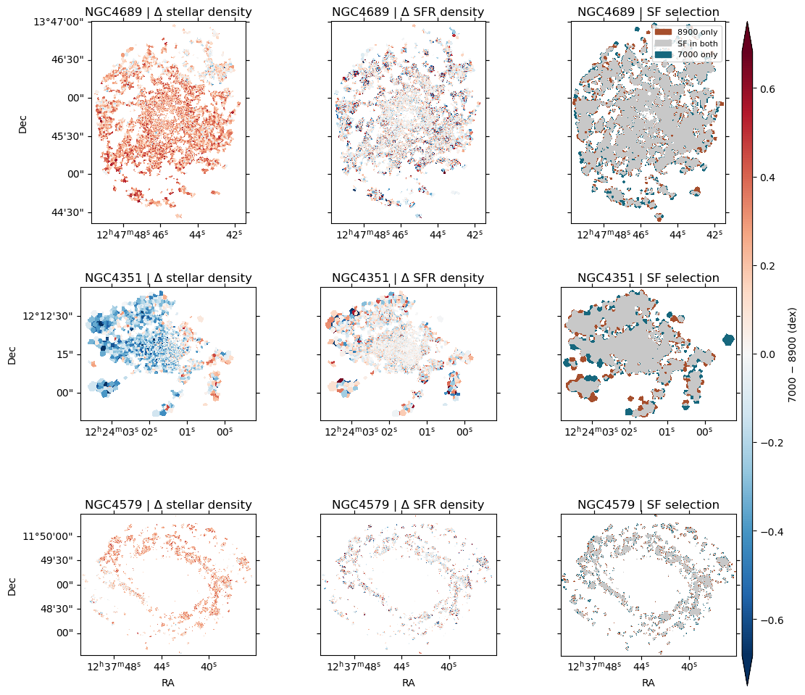
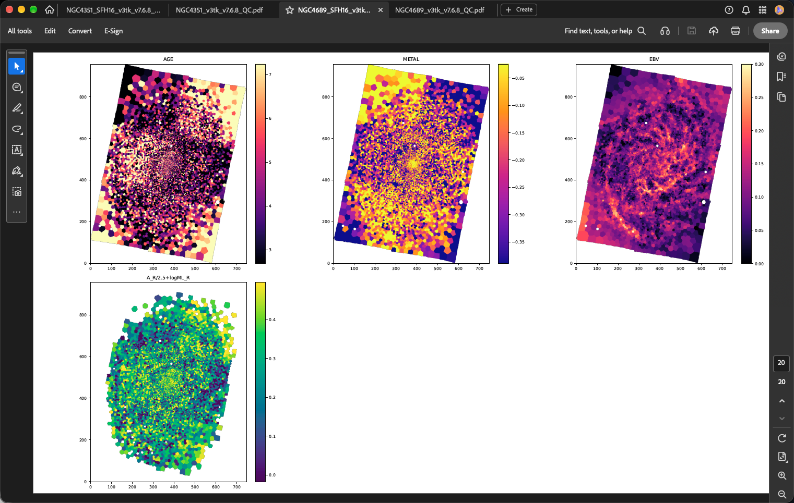
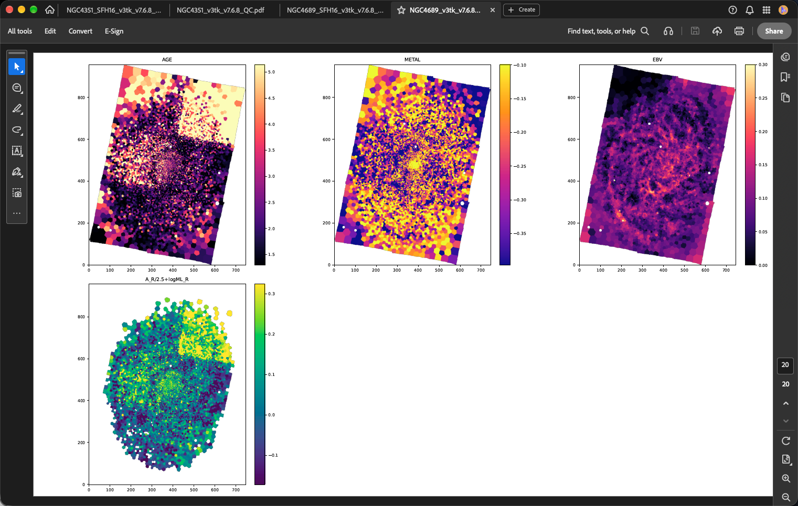
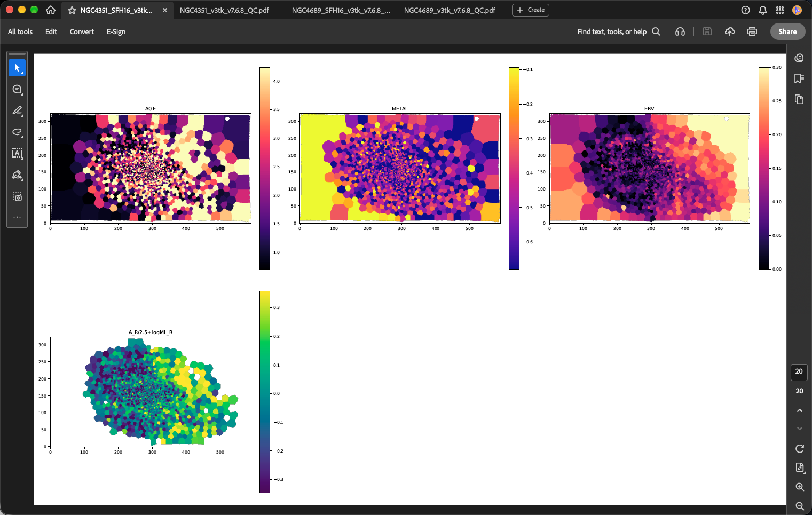
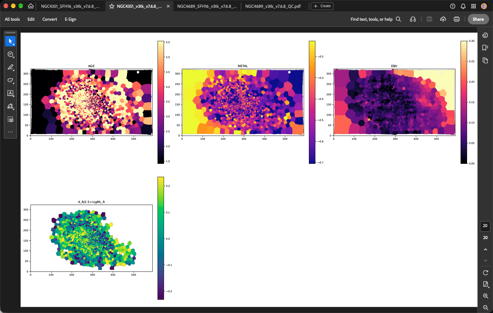

# 20261119 Initial Check of rSFMS between 7000 and 8900

When we look at the distribution of both stellar and SFR, the median, mean and half width of 68% of SFR are almost identical; while stellar mass spread wider in 7000 runs but i will say the median and mean are still similar. So wider distribution of stellar mass make the slope flattened. 

<table border="1" class="dataframe">
  <thead>
    <tr style="text-align: right;">
      <th></th>
      <th></th>
      <th>median</th>
      <th>mean</th>
      <th>half_P84_P16</th>
    </tr>
    <tr>
      <th>run</th>
      <th>axis</th>
      <th></th>
      <th></th>
      <th></th>
    </tr>
  </thead>
  <tbody>
    <tr>
      <th rowspan="2" valign="top">7000 (SFH16)</th>
      <th>log stellar density</th>
      <td>8.0241</td>
      <td>8.0132</td>
      <td>0.4000</td>
    </tr>
    <tr>
      <th>log SFR density</th>
      <td>-2.1485</td>
      <td>-2.1074</td>
      <td>0.5586</td>
    </tr>
    <tr>
      <th rowspan="2" valign="top">8900</th>
      <th>log stellar density</th>
      <td>7.9694</td>
      <td>7.9774</td>
      <td>0.3550</td>
    </tr>
    <tr>
      <th>log SFR density</th>
      <td>-2.1504</td>
      <td>-2.1091</td>
      <td>0.5569</td>
    </tr>
  </tbody>
</table>

And then we try to look at those galaxies that deviate the most in rSFMS parameter space by measuring each pixel moved in the log-log plane: \(\sqrt{(\Delta\log\Sigma_\star)^2+(\Delta\log\Sigma_{\rm SFR})^2}\), and the following 3 stand out.

| Rank | Galaxy  | Median distance moved | Median signed stellar-density shift |
| ---- | ------- | --------------------- | ----------------------------------- |
| 1    | NGC4689 | 0.284 dex             | +0.205 dex                          |
| 2    | NGC4351 | 0.268 dex             | −0.159 dex                          |
| 3    | NGC4579 | 0.254 dex             | +0.177 dex                          |

So NGC4689 and NGC4351 are doing the opposite direction and I think this different is clearly due to the M/L. 

So even the colorbar ranges are different, we can clearly see that if we ignore the top right pointting, the M/L is broadly higher (~0.2dex) in 7000 run in NGC4689.

On the other hand, NGC4351 is lower (focusing on the left pointing) due to 7000 run think those stellar should be younger. 

