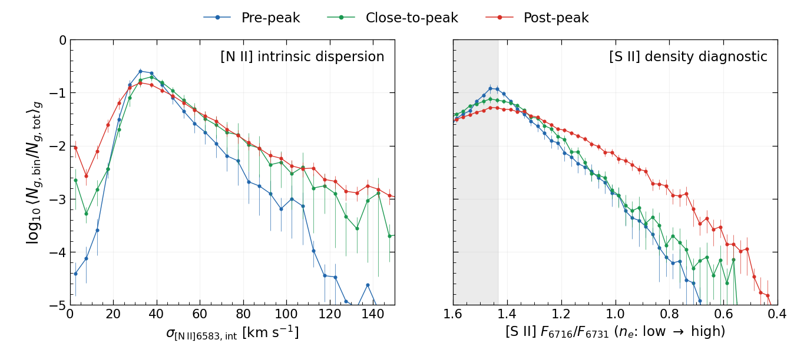
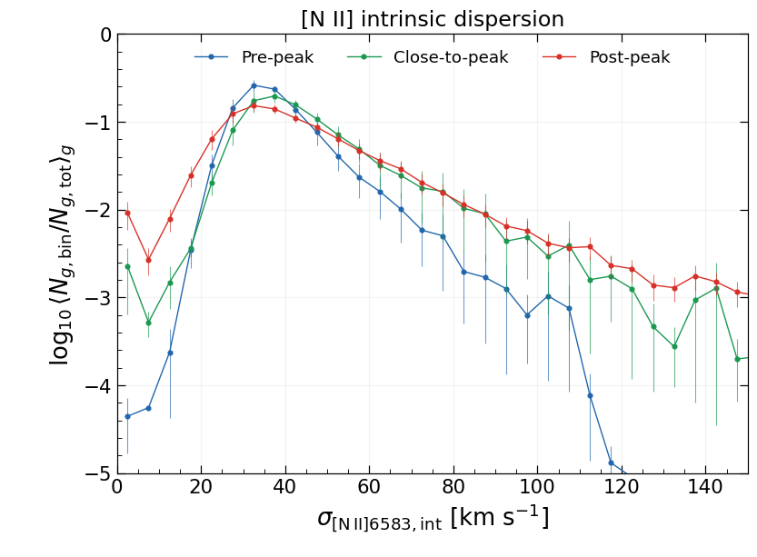
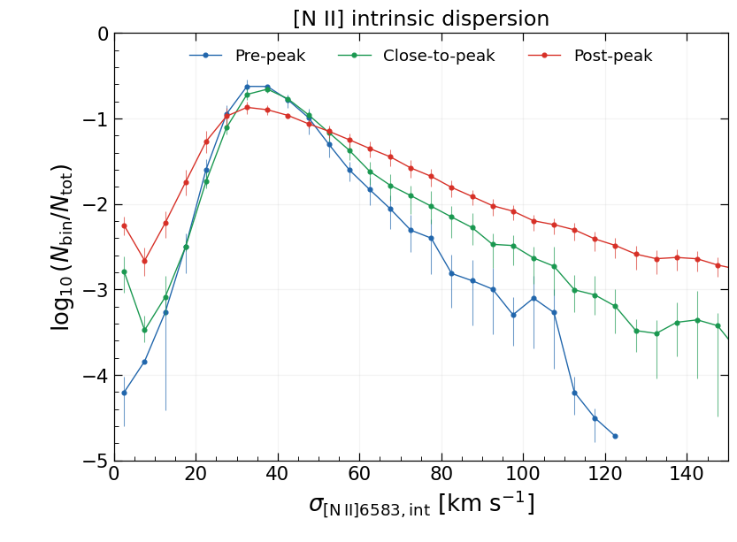
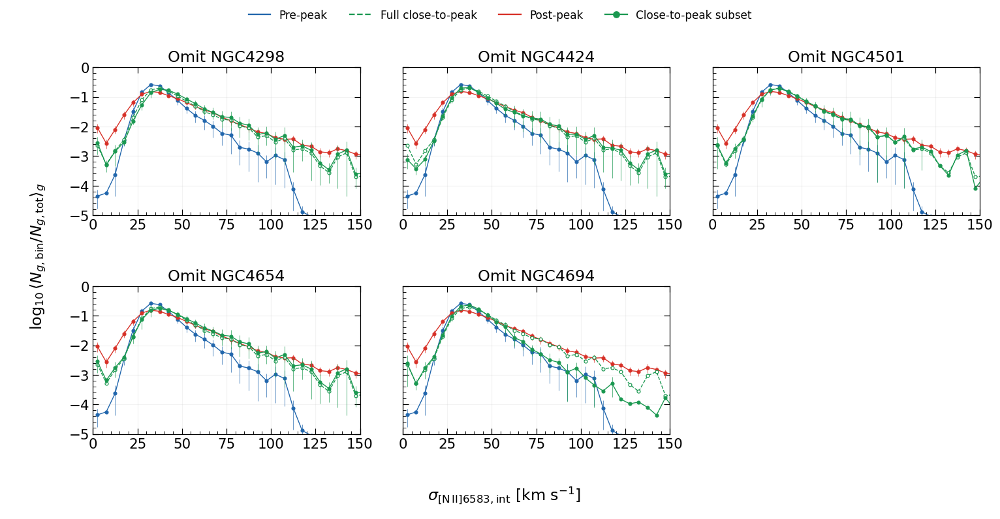
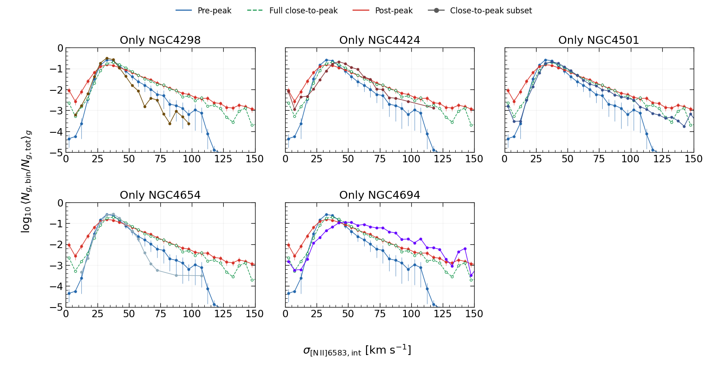

# 20261120 NGC4694 Is the Outlier in NII Dispersion

We notice that in [N II] dispersion histogram, close-to-peak sample behaves closer to post-peak distribution while in other plots it is closer to pre-peak. 

And if we do pool-spaxel plot it will go back to the middle between pre-peak and post-peak.

Actually, if we take one of the close-to-peak galaxy out in equal-galaxy distribution, then NGC4694 is the smoking gun that pust the histogram higher to post-peak one.

And when we further show the close-to-peak galaxy one-by-one in this plot, we can see that NGC4298 and NGC4654 are closer to pre-peak, and NGC4424 and NGC4501 are nearly in the middle, while NGC4694 has even higher high-dispersion fraction than post-peak. And i think this is consistent with the fact that its HI gas is the most disturbed (accretion+merger?). 

