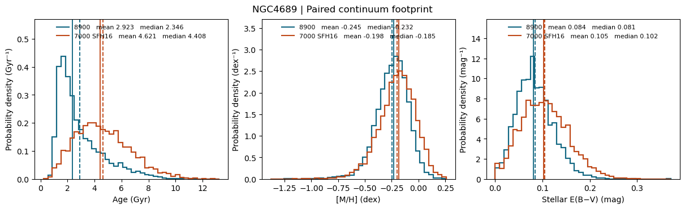
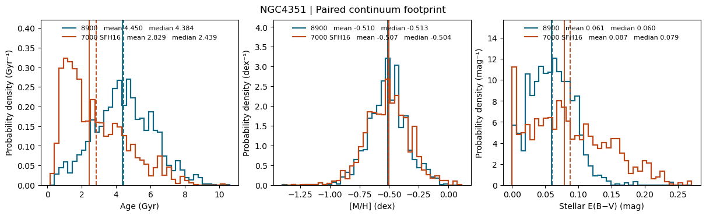
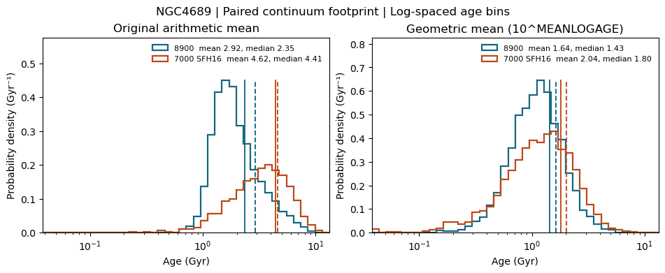
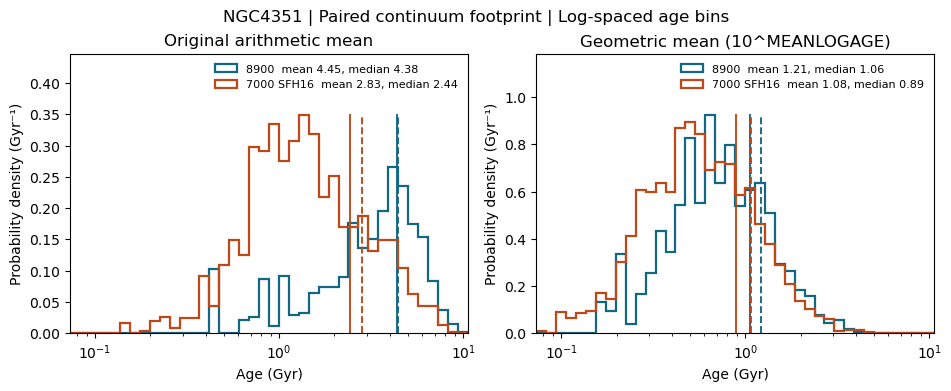
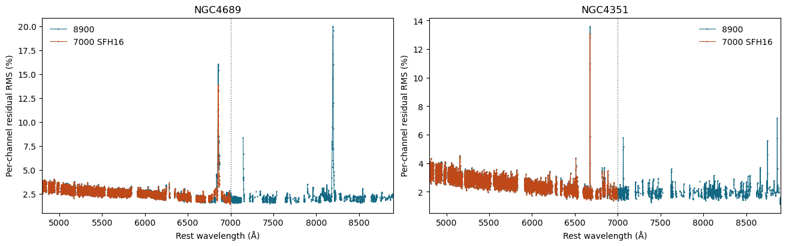

# 20261123 Age Check of rSFMS between 7000 and 8900

We already know that the change of rSFMS parameter space is primary in stellar mass map and it is mainly due to higher M/L in 7000 run than 8900 run. Then here we further look at the Age & [M/H] (both contribute to light weight) and E(B-V) (also contribute to stellar mass) to see what make these differences. 

We still pick those two extreme galaxies after selecting `SNR_POSRFIT`>25 and pairing spaxles, and it turns out it is primary due to estimated population in the 7000 run: NGC4689 is older and NGC4351 is younger, while metallicity and extinction maps are similar or changed less. For example, both mean and median of Age are shifted by $\pm0.17\sim0.2$ dex while metallicity and E(B-V) are $\pm0.01\sim0.02$ dex. 

<table id="T_c28e9">
  <thead>
    <tr>
      <th class="blank level0" >&nbsp;</th>
      <th id="T_c28e9_level0_col0" class="col_heading level0 col0" >Galaxy</th>
      <th id="T_c28e9_level0_col1" class="col_heading level0 col1" >Quantity</th>
      <th id="T_c28e9_level0_col2" class="col_heading level0 col2" >Unit</th>
      <th id="T_c28e9_level0_col3" class="col_heading level0 col3" >Run</th>
      <th id="T_c28e9_level0_col4" class="col_heading level0 col4" >Paired spaxels</th>
      <th id="T_c28e9_level0_col5" class="col_heading level0 col5" >Mean</th>
      <th id="T_c28e9_level0_col6" class="col_heading level0 col6" >Median</th>
      <th id="T_c28e9_level0_col7" class="col_heading level0 col7" >P16</th>
      <th id="T_c28e9_level0_col8" class="col_heading level0 col8" >P84</th>
      <th id="T_c28e9_level0_col9" class="col_heading level0 col9" >P84−P16</th>
    </tr>
  </thead>
  <tbody>
    <tr>
      <th id="T_c28e9_level0_row0" class="row_heading level0 row0" >0</th>
      <td id="T_c28e9_row0_col0" class="data row0 col0" >NGC4689</td>
      <td id="T_c28e9_row0_col1" class="data row0 col1" >Age</td>
      <td id="T_c28e9_row0_col2" class="data row0 col2" >Gyr</td>
      <td id="T_c28e9_row0_col3" class="data row0 col3" >8900</td>
      <td id="T_c28e9_row0_col4" class="data row0 col4" >352045</td>
      <td id="T_c28e9_row0_col5" class="data row0 col5" >2.9229</td>
      <td id="T_c28e9_row0_col6" class="data row0 col6" >2.3462</td>
      <td id="T_c28e9_row0_col7" class="data row0 col7" >1.4722</td>
      <td id="T_c28e9_row0_col8" class="data row0 col8" >4.5959</td>
      <td id="T_c28e9_row0_col9" class="data row0 col9" >3.1237</td>
    </tr>
    <tr>
      <th id="T_c28e9_level0_row1" class="row_heading level0 row1" >1</th>
      <td id="T_c28e9_row1_col0" class="data row1 col0" >NGC4689</td>
      <td id="T_c28e9_row1_col1" class="data row1 col1" >Age</td>
      <td id="T_c28e9_row1_col2" class="data row1 col2" >Gyr</td>
      <td id="T_c28e9_row1_col3" class="data row1 col3" >7000 SFH16</td>
      <td id="T_c28e9_row1_col4" class="data row1 col4" >352045</td>
      <td id="T_c28e9_row1_col5" class="data row1 col5" >4.6212</td>
      <td id="T_c28e9_row1_col6" class="data row1 col6" >4.4077</td>
      <td id="T_c28e9_row1_col7" class="data row1 col7" >2.5686</td>
      <td id="T_c28e9_row1_col8" class="data row1 col8" >6.6781</td>
      <td id="T_c28e9_row1_col9" class="data row1 col9" >4.1096</td>
    </tr>
    <tr>
      <th id="T_c28e9_level0_row2" class="row_heading level0 row2" >2</th>
      <td id="T_c28e9_row2_col0" class="data row2 col0" >NGC4689</td>
      <td id="T_c28e9_row2_col1" class="data row2 col1" >[M/H]</td>
      <td id="T_c28e9_row2_col2" class="data row2 col2" >dex</td>
      <td id="T_c28e9_row2_col3" class="data row2 col3" >8900</td>
      <td id="T_c28e9_row2_col4" class="data row2 col4" >352045</td>
      <td id="T_c28e9_row2_col5" class="data row2 col5" >-0.2445</td>
      <td id="T_c28e9_row2_col6" class="data row2 col6" >-0.2323</td>
      <td id="T_c28e9_row2_col7" class="data row2 col7" >-0.3825</td>
      <td id="T_c28e9_row2_col8" class="data row2 col8" >-0.1034</td>
      <td id="T_c28e9_row2_col9" class="data row2 col9" >0.2791</td>
    </tr>
    <tr>
      <th id="T_c28e9_level0_row3" class="row_heading level0 row3" >3</th>
      <td id="T_c28e9_row3_col0" class="data row3 col0" >NGC4689</td>
      <td id="T_c28e9_row3_col1" class="data row3 col1" >[M/H]</td>
      <td id="T_c28e9_row3_col2" class="data row3 col2" >dex</td>
      <td id="T_c28e9_row3_col3" class="data row3 col3" >7000 SFH16</td>
      <td id="T_c28e9_row3_col4" class="data row3 col4" >352045</td>
      <td id="T_c28e9_row3_col5" class="data row3 col5" >-0.1983</td>
      <td id="T_c28e9_row3_col6" class="data row3 col6" >-0.1849</td>
      <td id="T_c28e9_row3_col7" class="data row3 col7" >-0.3612</td>
      <td id="T_c28e9_row3_col8" class="data row3 col8" >-0.0330</td>
      <td id="T_c28e9_row3_col9" class="data row3 col9" >0.3281</td>
    </tr>
    <tr>
      <th id="T_c28e9_level0_row4" class="row_heading level0 row4" >4</th>
      <td id="T_c28e9_row4_col0" class="data row4 col0" >NGC4689</td>
      <td id="T_c28e9_row4_col1" class="data row4 col1" >Stellar E(B−V)</td>
      <td id="T_c28e9_row4_col2" class="data row4 col2" >mag</td>
      <td id="T_c28e9_row4_col3" class="data row4 col3" >8900</td>
      <td id="T_c28e9_row4_col4" class="data row4 col4" >352045</td>
      <td id="T_c28e9_row4_col5" class="data row4 col5" >0.0841</td>
      <td id="T_c28e9_row4_col6" class="data row4 col6" >0.0809</td>
      <td id="T_c28e9_row4_col7" class="data row4 col7" >0.0464</td>
      <td id="T_c28e9_row4_col8" class="data row4 col8" >0.1224</td>
      <td id="T_c28e9_row4_col9" class="data row4 col9" >0.0760</td>
    </tr>
    <tr>
      <th id="T_c28e9_level0_row5" class="row_heading level0 row5" >5</th>
      <td id="T_c28e9_row5_col0" class="data row5 col0" >NGC4689</td>
      <td id="T_c28e9_row5_col1" class="data row5 col1" >Stellar E(B−V)</td>
      <td id="T_c28e9_row5_col2" class="data row5 col2" >mag</td>
      <td id="T_c28e9_row5_col3" class="data row5 col3" >7000 SFH16</td>
      <td id="T_c28e9_row5_col4" class="data row5 col4" >352045</td>
      <td id="T_c28e9_row5_col5" class="data row5 col5" >0.1049</td>
      <td id="T_c28e9_row5_col6" class="data row5 col6" >0.1020</td>
      <td id="T_c28e9_row5_col7" class="data row5 col7" >0.0551</td>
      <td id="T_c28e9_row5_col8" class="data row5 col8" >0.1540</td>
      <td id="T_c28e9_row5_col9" class="data row5 col9" >0.0989</td>
    </tr>
    <tr>
      <th id="T_c28e9_level0_row6" class="row_heading level0 row6" >6</th>
      <td id="T_c28e9_row6_col0" class="data row6 col0" >NGC4351</td>
      <td id="T_c28e9_row6_col1" class="data row6 col1" >Age</td>
      <td id="T_c28e9_row6_col2" class="data row6 col2" >Gyr</td>
      <td id="T_c28e9_row6_col3" class="data row6 col3" >8900</td>
      <td id="T_c28e9_row6_col4" class="data row6 col4" >76341</td>
      <td id="T_c28e9_row6_col5" class="data row6 col5" >4.4496</td>
      <td id="T_c28e9_row6_col6" class="data row6 col6" >4.3838</td>
      <td id="T_c28e9_row6_col7" class="data row6 col7" >2.6541</td>
      <td id="T_c28e9_row6_col8" class="data row6 col8" >6.1667</td>
      <td id="T_c28e9_row6_col9" class="data row6 col9" >3.5126</td>
    </tr>
    <tr>
      <th id="T_c28e9_level0_row7" class="row_heading level0 row7" >7</th>
      <td id="T_c28e9_row7_col0" class="data row7 col0" >NGC4351</td>
      <td id="T_c28e9_row7_col1" class="data row7 col1" >Age</td>
      <td id="T_c28e9_row7_col2" class="data row7 col2" >Gyr</td>
      <td id="T_c28e9_row7_col3" class="data row7 col3" >7000 SFH16</td>
      <td id="T_c28e9_row7_col4" class="data row7 col4" >76341</td>
      <td id="T_c28e9_row7_col5" class="data row7 col5" >2.8288</td>
      <td id="T_c28e9_row7_col6" class="data row7 col6" >2.4391</td>
      <td id="T_c28e9_row7_col7" class="data row7 col7" >1.0576</td>
      <td id="T_c28e9_row7_col8" class="data row7 col8" >4.6807</td>
      <td id="T_c28e9_row7_col9" class="data row7 col9" >3.6231</td>
    </tr>
    <tr>
      <th id="T_c28e9_level0_row8" class="row_heading level0 row8" >8</th>
      <td id="T_c28e9_row8_col0" class="data row8 col0" >NGC4351</td>
      <td id="T_c28e9_row8_col1" class="data row8 col1" >[M/H]</td>
      <td id="T_c28e9_row8_col2" class="data row8 col2" >dex</td>
      <td id="T_c28e9_row8_col3" class="data row8 col3" >8900</td>
      <td id="T_c28e9_row8_col4" class="data row8 col4" >76341</td>
      <td id="T_c28e9_row8_col5" class="data row8 col5" >-0.5102</td>
      <td id="T_c28e9_row8_col6" class="data row8 col6" >-0.5130</td>
      <td id="T_c28e9_row8_col7" class="data row8 col7" >-0.6562</td>
      <td id="T_c28e9_row8_col8" class="data row8 col8" >-0.3614</td>
      <td id="T_c28e9_row8_col9" class="data row8 col9" >0.2948</td>
    </tr>
    <tr>
      <th id="T_c28e9_level0_row9" class="row_heading level0 row9" >9</th>
      <td id="T_c28e9_row9_col0" class="data row9 col0" >NGC4351</td>
      <td id="T_c28e9_row9_col1" class="data row9 col1" >[M/H]</td>
      <td id="T_c28e9_row9_col2" class="data row9 col2" >dex</td>
      <td id="T_c28e9_row9_col3" class="data row9 col3" >7000 SFH16</td>
      <td id="T_c28e9_row9_col4" class="data row9 col4" >76341</td>
      <td id="T_c28e9_row9_col5" class="data row9 col5" >-0.5073</td>
      <td id="T_c28e9_row9_col6" class="data row9 col6" >-0.5041</td>
      <td id="T_c28e9_row9_col7" class="data row9 col7" >-0.6816</td>
      <td id="T_c28e9_row9_col8" class="data row9 col8" >-0.3297</td>
      <td id="T_c28e9_row9_col9" class="data row9 col9" >0.3519</td>
    </tr>
    <tr>
      <th id="T_c28e9_level0_row10" class="row_heading level0 row10" >10</th>
      <td id="T_c28e9_row10_col0" class="data row10 col0" >NGC4351</td>
      <td id="T_c28e9_row10_col1" class="data row10 col1" >Stellar E(B−V)</td>
      <td id="T_c28e9_row10_col2" class="data row10 col2" >mag</td>
      <td id="T_c28e9_row10_col3" class="data row10 col3" >8900</td>
      <td id="T_c28e9_row10_col4" class="data row10 col4" >76341</td>
      <td id="T_c28e9_row10_col5" class="data row10 col5" >0.0606</td>
      <td id="T_c28e9_row10_col6" class="data row10 col6" >0.0599</td>
      <td id="T_c28e9_row10_col7" class="data row10 col7" >0.0264</td>
      <td id="T_c28e9_row10_col8" class="data row10 col8" >0.0936</td>
      <td id="T_c28e9_row10_col9" class="data row10 col9" >0.0672</td>
    </tr>
    <tr>
      <th id="T_c28e9_level0_row11" class="row_heading level0 row11" >11</th>
      <td id="T_c28e9_row11_col0" class="data row11 col0" >NGC4351</td>
      <td id="T_c28e9_row11_col1" class="data row11 col1" >Stellar E(B−V)</td>
      <td id="T_c28e9_row11_col2" class="data row11 col2" >mag</td>
      <td id="T_c28e9_row11_col3" class="data row11 col3" >7000 SFH16</td>
      <td id="T_c28e9_row11_col4" class="data row11 col4" >76341</td>
      <td id="T_c28e9_row11_col5" class="data row11 col5" >0.0872</td>
      <td id="T_c28e9_row11_col6" class="data row11 col6" >0.0793</td>
      <td id="T_c28e9_row11_col7" class="data row11 col7" >0.0242</td>
      <td id="T_c28e9_row11_col8" class="data row11 col8" >0.1529</td>
      <td id="T_c28e9_row11_col9" class="data row11 col9" >0.1286</td>
    </tr>
  </tbody>
</table>

Notice that in `nGIST` v7.6.18 they update the calculation of Age from ⟨Age⟩ to ⟨log₁₀(Age/Gyr)⟩, which make younger stellar have more contributions. So i redo the calculation so reflect this, and we still see that difference in Age distribution. 

And we can also access the fitting goodness by looking at the RMS between 2 runs in exact paired bins. 
$$
\mathrm{RMS}_{\%}=100\frac{\sqrt{\langle(F_{\mathrm{obs}}-F_{\mathrm{fit}})^2\rangle}}{\operatorname{median}(F_{\mathrm{obs}})}.
$$
We can see that 7000 SFH16 fits have slightly smaller residuals in both galaxies between the same $4800-7000\AA$ window, but if consider the full fitting range then NGC4351 shows better fitting in 8900 run. which run. So i think recovers the more accurate ages is still open and this may be simply due to the effect of fitting range. 

<table border="1" class="dataframe">
  <thead>
    <tr style="text-align: right;">
      <th></th>
      <th>Galaxy</th>
      <th>Run</th>
      <th>Window (Å)</th>
      <th>Exact pairs</th>
      <th>Valid pairs</th>
      <th>Channels</th>
      <th>P16 RMS (%)</th>
      <th>Median RMS (%)</th>
      <th>P84 RMS (%)</th>
    </tr>
  </thead>
  <tbody>
    <tr>
      <th>0</th>
      <td>NGC4689</td>
      <td>7000 SFH16</td>
      <td>4800–7000</td>
      <td>855</td>
      <td>855</td>
      <td>2208</td>
      <td>2.5198</td>
      <td>2.8178</td>
      <td>3.0548</td>
    </tr>
    <tr>
      <th>1</th>
      <td>NGC4689</td>
      <td>8900</td>
      <td>4800–8900</td>
      <td>855</td>
      <td>855</td>
      <td>3031</td>
      <td>2.6224</td>
      <td>2.8891</td>
      <td>3.1064</td>
    </tr>
    <tr>
      <th>2</th>
      <td>NGC4689</td>
      <td>8900</td>
      <td>4800–7000</td>
      <td>855</td>
      <td>855</td>
      <td>2210</td>
      <td>2.6068</td>
      <td>2.8967</td>
      <td>3.1314</td>
    </tr>
    <tr>
      <th>3</th>
      <td>NGC4689</td>
      <td>8900</td>
      <td>&gt;7000–8900</td>
      <td>855</td>
      <td>855</td>
      <td>821</td>
      <td>2.6476</td>
      <td>2.8466</td>
      <td>3.0743</td>
    </tr>
    <tr>
      <th>4</th>
      <td>NGC4351</td>
      <td>7000 SFH16</td>
      <td>4800–7000</td>
      <td>159</td>
      <td>159</td>
      <td>2206</td>
      <td>2.5296</td>
      <td>2.7000</td>
      <td>2.8686</td>
    </tr>
    <tr>
      <th>5</th>
      <td>NGC4351</td>
      <td>8900</td>
      <td>4800–8900</td>
      <td>159</td>
      <td>159</td>
      <td>3018</td>
      <td>2.3919</td>
      <td>2.5380</td>
      <td>2.7322</td>
    </tr>
    <tr>
      <th>6</th>
      <td>NGC4351</td>
      <td>8900</td>
      <td>4800–7000</td>
      <td>159</td>
      <td>159</td>
      <td>2207</td>
      <td>2.5505</td>
      <td>2.7135</td>
      <td>2.8805</td>
    </tr>
    <tr>
      <th>7</th>
      <td>NGC4351</td>
      <td>8900</td>
      <td>&gt;7000–8900</td>
      <td>159</td>
      <td>159</td>
      <td>811</td>
      <td>1.8502</td>
      <td>2.0043</td>
      <td>2.2313</td>
    </tr>
  </tbody>
</table>
