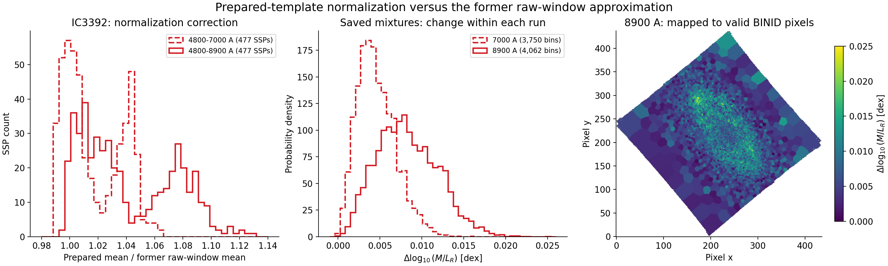
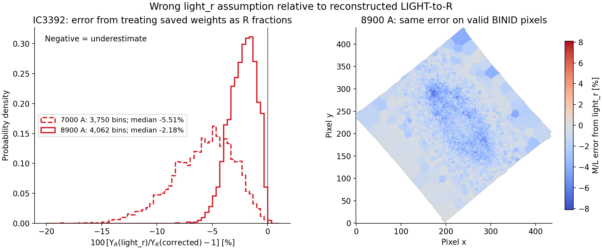

# Mass LIGHT-to-R refinement: implementation and validation, 2026-10-29/30

This implements the normalization refinement discussed in conversation
`01a18227-14b4-7d00-854c-2cc09077e822` and specified in
`../../MAUVE/20261029_MAUVE_ML_R_Normalization_Refinement.md`.

## What happened and what changed

The previous `Mass.py` helper took `nanmean` of original linearly sampled SSP
flux over inclusive `LMIN`--`LMAX`. The 2026-04-23 changelog called this exact,
but it omitted operations nGIST performs before LIGHT normalization. The
reconstruction now uses nGIST's strict padded crop, wavelength-dependent LSF
convolution, pPXF `log_rebin` at galaxy `VELSCALE/2`, then `np.mean` immediately
before the reference template division. No NaN-skipping mean is substituted.

The conversion remains `q=w*ell_R/n`, `f_R=q/sum(q)`, `ML_R=sum(f_R*SSP_ML_R)`.
The divisor is corrected; the fitted weights, accepted matched SSP/BaSTI
models, R-band definition and subsequent photometry remain the inputs.

All normalization functions are now directly in `../Mass.py`, following the
2026-10-30 user correction. The separate normalization module was removed.
The script includes the cause, corrected algorithm and scaling explanation
in its dated changelog and inline comments. Tests and the validator compile
the exact in-file definitions without starting the script's top-level pipeline;
the full executable is also exercised with temporary synthetic inputs.
`../Mass.sh` forwards overrides
and checks the additional dependencies. `../README.md` documents inputs and
behavior. Both production LSF files were copied directly beside `Mass.py`,
as requested. Their source location and checksums are recorded in that README.
The parent `.gitignore` allows these two exact extensionless LSF filenames so
the bundled resources can be included in a later commit.

Missing reconstruction inputs now stop the requested calculation. The former
automatic `light_v_to_r` fallback is removed. Other weight conventions remain
explicit CLI choices. CONFIG/header conflicts, a mismatched CONFIG `RUN_ID`,
duplicate/missing SSP identities, inconsistent wavelength grids, non-finite
spectra, negative weights and invalid factors/fractions are rejected.

## Check against the earlier discussion

The final integrated `Mass.py` was checked against the report's Section 13:

| Requirement from the discussion | Final implementation and check |
|---|---|
| Use this run's limits and inputs, not its folder name | `load_run_setup` checks saved SFH header settings against the selected CONFIG and verifies RUN_ID. |
| Reproduce actual nGIST LSF behavior | `load_lsf` retains redshift transformations, the historical floor expression and linear extrapolation; both LSF interpolators match the reference. |
| Include nGIST's crop/padding | `build_template_norm_flux_lookup` uses the same strict inequalities, 150-Angstrom overhead and 5-Angstrom library-edge rule, with a shared-grid check. |
| Use template sampling at half the galaxy step | Read CONFIG.PREPARE_SPECTRA.VELSCALE directly; no HDF5 spectra are needed. The installed Setonix SFH wrapper's ratio of two was verified. |
| Take the mean at the LIGHT division site | Convolve with pPXF `gaussian_filter1d`, use `log_rebin`, then `np.mean(prepared)`. No raw-window or NaN-skipping substitute. |
| Keep every quantity in saved SSP GRID order | Explicit complete/unique age-metal-alpha matching; the reference comparison reorders back to each saved GRID. |
| Preserve matched BaSTI R magnitudes and M/L | The same table quantities and `ell_R=10**(-0.4*R)` enter the calculation. No model recalibration was introduced. |
| Divide the luminosity contribution by n_j | `r_light_mass_to_light` computes `w*ell_R/n_j`, then normalizes per bin. Comments explain the coefficient rescaling. |
| Normalize fractions and check M/L | Runtime checks cover positive finite factors/denominators, nonnegative weights, unit fraction sums, equivalent M/L formulas and contributing-SSP extrema. |
| Compare against actual nGIST output | All 477 factor and normalized-spectrum comparisons pass locally for both windows and on Setonix for three real runs. |
| Distinguish arithmetic from regenerated products | The reported differences use saved mixtures; full executable tests write synthetic products only to temporary directories. |
| Keep the implementation in Mass.py | All normalization definitions are in Mass.py; the standalone module is removed and a structural regression test enforces this. |

## Fresh reference comparison

Downloaded `prepareTemplates/miles.py` and `auxiliary/_auxiliary.py` from
nGIST commit `038e9fa4839758e9dae53baeaf93a82bd75d8026`.
`../validate_mass_light_normalization.py` compiles the final `Mass.py` functions
and the original reference function ASTs
without changing their numerical statements. Only their status printer is
replaced by a silent printer. It runs the full `sortInGrid=True` preparation,
checks saved GRID identities, compares reference unnormalized means with the
new factors, and compares reconstructed normalized spectra with the original
LIGHT output. A second reference call disables normalization solely to expose
the pre-division spectra; it performs no fitting.

| Input | 4800--7000 run | 4800--8900 run |
|---|---:|---:|
| Real IC3392 weight rows | 3750 | 4062 |
| SSPs checked | 477 | 477 |
| Actual retained template endpoints [Angstrom] | 4650.2--7149.5 | 4650.2--9049.4 |
| Maximum relative error in reconstructed normalization factors | 0 | 0 |
| Maximum absolute difference in normalized spectra | 0 | 0 |
| Maximum R-fraction sum error | 4.44e-16 | 4.44e-16 |

The zero differences apply to these runs under the current numerical stack:
pPXF 9.4.2, NumPy 2.2.6, SciPy 1.15.2 and Astropy 7.0.2. They do not establish
bit-for-bit identity with every historical production software environment.
The data-LSF and template-LSF interpolated values also matched the original
`getLSF` function exactly at 100 wavelengths from 4600 to 9300 Angstrom.

The 8900 weights and CONFIG were read from local
`../v3tk_v7.6.8/IC3392/`. The local 7000 directory contained logs only, so the
7000 weights and CONFIG were copied read-only from Setonix:

```text
/scratch/pawsey1308/mauve/products/v3tk_v7.6.8_7000/IC3392/
    CONFIG
    IC3392_sfh_weights.fits
```

Those copies and all derived numerical arrays remain under
`/private/tmp/mass_norm_refinement/`. The JSON summaries here preserve the
input/config/reference-source/SSP hashes and preparation settings. Neither
checked run supplied a local binned-spectra HDF5; both use the directly read
CONFIG value of 41 km/s, giving a template step of 20.5 km/s. This is the normal
post-processing path, not a fallback. A regression test also places an invalid
intermediate HDF5 beside the weights and verifies that Mass.py ignores it.

## Effect of the corrected divisor on the saved mixtures

Each entry below compares the new prepared mean with the former raw-window
mean using the same saved weights and BaSTI properties within that run.
These are model-arithmetic comparisons, not observed changes between fitting
runs, and are not a total stellar-mass uncertainty budget.

| Per-bin delta log10(M/L_R), dex | 7000 | 8900 |
|---|---:|---:|
| Minimum | -0.00007620 | 0.00008382 |
| 16th percentile | 0.00231433 | 0.00456555 |
| Median | 0.00430326 | 0.00793773 |
| 84th percentile | 0.00683453 | 0.01209619 |
| Maximum | 0.01600170 | 0.02489910 |

The median changes correspond to about +1.00% and +1.84%, respectively.
The two runs have different bin counts; their distributions are normalized
separately and are not treated as paired bins. No galaxy-integrated mass change
is inferred from these unweighted bin statistics.



The figure shows the per-SSP factor ratios, per-bin M/L changes and the 8900
change mapped onto its existing BINID geometry. The spatial panel contains
94575 finite pixels with nonnegative in-range BINID; each pixel receives its
bin's calculated delta. It reads only BINID from the existing further file,
does not use an old ML_R map as truth, and does not modify the map. IC3392's
histogram color comes from `MAUVE_galaxy_colors.dat`; the spatial colors encode
the numerical delta. An exportable vector copy is provided in
`IC3392_normalization_comparison.pdf`.

## Error from wrongly assuming `light_r`

The literal `light_r` calculation is `sum_j(w_j*SSP_ML_R,j)/sum_j(w_j)`.
It assumes the saved coefficients already represent R-band luminosity
fractions. The comparison below keeps each run's saved weights and SSP
properties fixed, and uses the fully reconstructed LIGHT-to-R result as the
denominator. Define:

```text
delta_r = log10(ML_R(light_r) / ML_R(corrected_light_norm_to_r))
error_percent = 100 * (ML_R(light_r) / ML_R(corrected_light_norm_to_r) - 1)
```

Negative values mean an underestimate from `light_r`. These are unweighted
per-bin distributions over all valid saved weights rows, not galaxy-integrated
mass differences or a direct comparison between the two different bin sets.

| `light_r` error statistic | 7000 (3750 bins) | 8900 (4062 bins) |
|---|---:|---:|
| Median delta_r [dex] | -0.0246246 | -0.00957628 |
| 16th--84th percentile delta_r [dex] | -0.0390502 to -0.0134619 | -0.0158942 to -0.00451403 |
| Median M/L error [%] | -5.5123 | -2.1809 |
| 16th--84th percentile M/L error [%] | -8.5992 to -3.0522 | -3.5936 to -1.0340 |
| Minimum--maximum M/L error [%] | -18.4232 to +0.1269 | -8.0447 to +0.1428 |
| Bins with underestimate | 3748 / 3750 | 4055 / 4062 |



The histograms are normalized separately for the two runs. The spatial panel
maps the 8900 percentage error onto the same 94575 valid BINID pixels as the
earlier figure. The vector export is `IC3392_light_r_comparison.pdf`.
The sign is not universal: a few bins give small positive differences. A pure
single-SSP mixture always returns that SSP's M/L under either interpretation;
the effect appears when the band conversion changes a mixed population's
fractions. The test suite covers both this agreement case and a mixture where
the incorrect `light_r` result differs.

These values differ from the earlier +0.0043/+0.0079 dex normalization
refinement comparison: that comparison used the former raw-window divisor,
whereas this one omits the band conversion entirely. `Mass.py` now prints the
explicit ratio definition and its dex/percentage percentiles in its logs.

## Regression and integration checks

- Before implementation, a synthetic curved SSP reproduced the defect:
  raw-window mean 1.700196002931 versus prepared mean 1.648803039899, a
  3.116986% discrepancy. This is a normalization example, not a galaxy result.
- `python -m pytest -q tests/test_mass_light_normalization.py`: **13 passed**
  after direct integration on 2026-10-30.
  Coverage includes the corrected mean, missing CONFIG, wrong RUN_ID,
  conflicting LMAX, CONFIG-only sampling with ignored intermediates, duplicate/missing SSP identities, differing
  wavelength grids, non-finite spectra, R-fraction sums/scaling invariance,
  negative weights and historical LSF extrapolation/floor behavior.
- A full `Mass.py` run on a temporary 2x2 synthetic cube with two SSPs passed.
  Reopened FITS output has finite ML_R, LOGMSTAR, LOGMASS_SURFACE_DENSITY and
  error maps, plus MLMODE, MLNORM and the input/preparation HISTORY records.
  All synthetic products are under `/private/tmp`; no science map was replaced.
- Relevant legacy selection:
  `python -m pytest -q tests/test_mass_light_normalization.py test_fits_gz_resolution.py -k 'mass or phangs or gzip'`
  gave **21 passed, 1 failed, 5 deselected** after the 2026-10-30 integration
  (the initial 2026-10-29 selection had 18 passes). The failure is
  `test_shell_defaults_include_phangs_and_keep_cli_override`, which assumes
  an obsolete literal quoted galaxy-list/argument form. The same test was
  executed against all three unmodified HEAD wrappers in a temporary directory
  and failed there too. It is pre-existing and was left outside this fix.
- `bash -n Mass.sh`, Python source compilation, CLI help and scoped
  `git diff --check` passed. No commit or deployment was requested.
- Warnings from the test environment are pPXF/NumPy scalar-conversion
  deprecation and expected FITS HIERARCH warnings for long nGIST keywords.

## Setonix installed-nGIST checks on the final integrated script

Uploaded the exact final `Mass.py` into the dedicated temporary directory
`/scratch/pawsey1308/mass_norm_20261030.BpVuG6`. The saved
`setonix_validation_20261030.json` records its SHA256; it matches the current
local script and both refreshed local JSON summaries.

The check imported the actual installed nGIST 7.6.8 `miles` and `getLSF`
functions, rather than substituting the downloaded reference. It also checked
that the installed SFH wrapper uses `velscale_ratio=2`. All three production
run checks now read CONFIG.PREPARE_SPECTRA.VELSCALE directly (41 km/s), so the
template step is 20.5 km/s. The earlier input audit found the same value in
the original intermediate HDF5 metadata; those files were verification evidence,
not a resource that final CANFAR products must retain. Mass.py no longer opens
any HDF5 file, and Mass.sh no longer requires h5py. Production inputs are read-only.

| Run | Weight rows | SSPs | Max factor relative difference | Max normalized-spectrum absolute difference |
|---|---:|---:|---:|---:|
| IC3392, 4800--8900 | 4062 | 477 | 0 | 0 |
| IC3392, 4800--7000 | 3750 | 477 | 0 | 0 |
| NGC4064, 4800--7000 | 8841 | 477 | 0 | 0 |

The installed stack used pPXF 9.4.5 and NumPy 1.26.4, independently exercising
the final script under a different numerical environment from the local one.
The maximum R-fraction sum error was 4.44e-16 in every run. The IC3392 `light_r`
statistics reproduced the local results to floating-point precision. The
additional NGC4064 7000 sample gives median `light_r` error **-4.4629%**, with
16th--84th percentiles **-8.4934% to -2.0953%**, over its 8841 saved weight rows.
Its minimum--maximum error is -23.6331% to +0.8060%; these are still per-bin
comparisons, not an integrated galaxy mass measurement.

The numerical runner completed with `ALL_REFERENCE_CHECKS_PASSED` and exit
code 0.

The full unchanged `Mass.py` executable was also run in this scratch directory
on the 2x2 synthetic fixture, once for corrected `light_norm_to_r` and once
for explicit `light_r`. The installed environment lacks speclite, so a copy
of speclite 0.20 was staged under the test's scratch `pydeps` and added to the
test launcher's Python path. The installed environment was not modified.
Both executable runs and the subsequent output check passed. The saved
`setonix_smoke_20261030.json` records finite output maps, the selected modes,
source provenance, and identical R photometry between the modes.

The mass-log difference agrees with log10 of the M/L ratio within
8.50e-8 dex. The existing map workflow constructs intermediate M/L and
magnitude maps as float32 before exporting float64 FITS arrays, so this check
uses a bound derived from float32 rounding rather than demanding 1e-10 dex
after subtracting two rounded mass logs. The normalization-factor and
normalized-spectrum comparisons above use the full-precision SSP arrays and
still have zero difference from the installed reference.

## Reproducing the real-product check

Use the same SSP/BaSTI resources beside the scripts and a checked-out source
tree at the pinned revision. The source directory passed below must contain
`miles.py` and `_auxiliary.py` from that revision. The validator is scoped to
the current matched EMILES/BaSTI inputs in this project.

```bash
MPLCONFIGDIR=/tmp/mass_mpl python validate_mass_light_normalization.py \
  --weights v3tk_v7.6.8/IC3392/IC3392_sfh_weights.fits \
  --ngist-source-dir /path/to/pinned/reference_functions \
  --output-dir /tmp/mass_normalization_check
```

For the second run, pass its own 7000 weights with its own CONFIG beside it.
The validator writes JSON summaries and comparison arrays only to the chosen
output directory. The original report remains a dated specification snapshot;
this note records its subsequent implementation and numerical checks.

## Limits and remaining work

Existing production stellar-mass maps were not regenerated. No galaxy fits
were rerun. Full live-cube photometry was not rerun; integration was checked
with synthetic data. NGC4064 provides one additional 7000 comparison; numerical
impact was not measured for the rest of the sample.
Changing future fit-resolution assumptions is a separate analysis: historical
LSF extrapolation is intentionally reproduced here. SFH16 input packaging must
provide its actual run CONFIG; an ordinary-run CONFIG is not accepted as a
silent replacement. Existing unrelated SFH16 workflow files were not edited.
